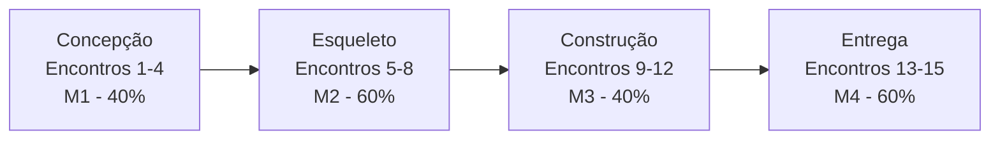

<div align="center">

# 🚗 AutoSaller — Sistema de Gestão de Vendas de Automóveis

**Um sistema, duas disciplinas.** Documentação pensada para orientar o time do começo ao fim do semestre.

</div>

**Equipe:** Ingridy Luzia · José Henrique · Maycon Douglas · Nicole Gabriel · Paulo Guilherme
**Curso:** Tecnologia em Sistemas para Internet (TSI) — IFRN

---

## 🧭 Índice

1. [Por que duas disciplinas em um só projeto](#-por-que-duas-disciplinas-em-um-só-projeto)
2. [O sistema em uma frase](#-o-sistema-em-uma-frase)
3. [Cronograma: dos 15 encontros aos 4 marcos](#️-cronograma-dos-15-encontros-aos-4-marcos)
4. [Ordem de construção: fatias verticais](#-ordem-de-construção-fatias-verticais)
5. [Checklist mínimo das duas disciplinas](#-checklist-mínimo-das-duas-disciplinas)
6. [Rubrica de Sistemas Corporativos (50 pts)](#-rubrica-de-sistemas-corporativos-50-pts--de-onde-vem-cada-ponto)
7. [Estrutura do repositório](#️-estrutura-sugerida-do-repositório)
8. [Fluxo de trabalho no Git](#-fluxo-de-trabalho-no-git)
9. [Erros que reprovam o grupo](#️-erros-que-reprovam-o-grupo)
10. [Documentação e referências](#-documentação-e-referências)

---

## 📌 Por que duas disciplinas em um só projeto?

O Projeto Integrador cobra um sistema completo, ponta-a-ponta, guiado por três âncoras — **Banco de Dados**, **Sistemas Corporativos** e **Processo de Desenvolvimento** — avaliado em 4 marcos (M1–M4). Sistemas Corporativos, sendo uma dessas âncoras, tem a sua própria rubrica de 50 pontos.

Construindo o **AutoSaller** para atender as duas ao mesmo tempo, cada funcionalidade entregue conta em dois lugares — no marco do Projeto Integrador **e** na nota de Sistemas Corporativos — sem duplicar esforço. É por isso que este README trata as duas disciplinas juntas, e não como documentos separados.

> **PoC vs. MVP vs. Product** (contexto rápido)
> - **PoC** — "isso é possível?" → protótipo descartável, só valida a ideia.
> - **MVP** — "isso resolve o problema de alguém?" → é o que o AutoSaller precisa ser até o M3.
> - **Product** — "isso se sustenta e escala?" → fora do escopo deste semestre.

---

## 🎯 O sistema em uma frase

Centralizar em uma aplicação web o processo de venda de veículos de uma concessionária, com dois perfis de acesso (**Administrador** e **Vendedor**) e 5 módulos integrados: **Vendas · Estoque · Clientes · Relatórios · Usuários**.

**Stack:** NestJS + PostgreSQL (back-end) · VueJS + TypeScript (front-end)
**Documento de requisitos:** já elaborado pelo grupo → [`docs/analise-de-requisitos.md`](docs/analise-de-requisitos.md)

---

## 🗺️ Cronograma: dos 15 encontros aos 4 marcos



| Bloco | Encontros | Marco | O que a banca espera | O que isso é no AutoSaller |
|---|---|---|---|---|
| 📋 Concepção | 1–4 | **M1** — Proposta do Projeto | Documento + pitch, escopo mínimo, orientador aceito, backlog, modelo de dados preliminar | Já temos: BRD completo, escopo dentro/fora, requisitos funcionais e não funcionais. Falta: orientador definido, backlog priorizado e cronograma formal |
| 🏗️ Esqueleto | 5–8 | **M2** — PoC ponta a ponta | Fluxo completo: tela → regra → banco → resposta, ao vivo | Ambiente montado (NestJS + PostgreSQL + VueJS) e a 1ª fatia vertical (login) no ar |
| 🔧 Construção | 9–12 | **M3** — MVP em homologação | Autenticação, 2 perfis, CRUDs centrais, consulta consolidada, dados de exemplo | Estoque, Clientes e Vendas funcionando de ponta a ponta + relatório consolidado |
| 🚀 Entrega | 13–15 | **M4** — Entrega final e banca | Sistema publicado por URL, relatório técnico ABNT, apresentação e arguição individual | Deploy final, relatório escrito, defesa de cada integrante |

---

## 🧩 Ordem de construção: fatias verticais

O maior risco de "sistema complexo demais" é dividir o trabalho **por camada** (uma pessoa só no front, outra só no banco) — ninguém integra nada até a última semana. A saída é dividir **por fatia vertical**: cada entrega atravessa banco → back-end → front-end e já sobe para o ar, mesmo que pequena.

A ordem abaixo segue a divisão que vocês já fizeram no documento de requisitos (cada módulo já tem um responsável natural, que foi quem escreveu os requisitos daquele módulo):

| # | Fatia | O que sobe ao ar | Requisitos atendidos | Sugestão de responsável |
|---|---|---|---|---|
| 1 | Autenticação & Perfis | Login funcional com 2 perfis (Admin / Vendedor) | RF-USU-\*, RNF004, RNF005 | Paulo Guilherme |
| 2 | Estoque | Cadastro, listagem e status do veículo (Disponível/Reservado/Vendido/Manutenção) | RF-EST-01 a 03 | Maycon Douglas |
| 3 | Clientes | CRUD de clientes | RF-CLI-01 a 05 | Nicole Gabriel |
| 4 | Vendas | Registrar venda, associar cliente/vendedor, baixa automática de estoque, comissão | RF-VEN-01 a 04 | Ingridy Luzia |
| 5 | Aprovação & Auditoria | Fluxo de desconto ≥ 10% + logs de ações críticas | RF-VEN-05, RF-USU-06/12, RNF007 | Ingridy Luzia / Paulo Guilherme |
| 6 | Relatórios consolidados | Faturamento, posição de estoque, desempenho por vendedor (join de +1 tabela) | RF-REL-01 a 03 | José Henrique |
| 7 · opcional | Extras se sobrar tempo | Test drive, dashboard gráfico, exportação PDF/CSV | RF-CLI-08/09, RF-REL-04/06 | a definir |

A fatia 6 é a que resolve, sozinha, a exigência de "consulta/relatório que agregue dados de mais de uma tabela" das duas disciplinas — vale priorizá-la assim que Estoque e Vendas estiverem de pé.

---

## ✅ Checklist mínimo das duas disciplinas

- [ ] Domínio delimitado e usuário identificável — concessionária / Administrador & Vendedor
- [ ] Consulta ou relatório que agregue dados de mais de uma tabela — RF-REL-01/02/03
- [ ] Cadastro e autenticação com pelo menos dois perfis — módulo Usuários
- [ ] Pelo menos 3 entidades relacionadas com integridade referencial — Veículo, Cliente, Venda, Usuário
- [ ] Fluxo principal ("caminho feliz") completo, sem erros — login → registrar venda → baixa de estoque → aparece no relatório
- [ ] CRUD completo (criar, listar, editar, remover) sobre as entidades centrais — Estoque e Clientes
- [ ] Validação de dados e tratamento de erro visível ao usuário — RF-EST-04, RF-CLI-05
- [ ] Repositório Git com histórico distribuído entre os 5 integrantes
- [ ] Sistema implantado e acessível por URL, com dados de exemplo carregados
- [ ] Relatório técnico em normas ABNT

---

## 📊 Rubrica de Sistemas Corporativos (50 pts) — de onde vem cada ponto

| Critério | Pontos | O que no AutoSaller comprova isso |
|---|---:|---|
| Domínio, requisitos e valor corporativo | 8 | BRD já elaborado — descrição, escopo, direcionadores de negócio |
| Arquitetura, modularidade e decisões registradas | 10 | Separação em camadas no NestJS (controller/service/repository), 5 módulos desacoplados, decisões registradas em `docs/decisoes-arquiteturais/` |
| Segurança, dados, transações e auditoria | 8 | Senhas com hash (RNF004), controle por perfil (RNF005), logs de auditoria (RF-USU-16) |
| Integração, resiliência e observabilidade | 8 | Módulos integrados em tempo real (venda → baixa automática de estoque), tratamento de erro visível |
| Testes, CI, contêineres e execução reproduzível | 6 | Testes automatizados, Docker Compose, pipeline simples de CI |
| Documentação, demonstração e defesa | 10 | Este README + relatório ABNT + apresentação final |

> **Regras que valem nota nessa disciplina:** todo mundo do grupo precisa dominar a solução inteira (a defesa é individual e pode ajustar a nota); código ou texto de terceiros usado precisa ser identificado e referenciado; a entrega precisa incluir instruções reproduzíveis e histórico de versão real.

---

## 🗂️ Estrutura sugerida do repositório

Um **monorepo único** (um repositório só, com back-end, front-end e documentação juntos) é o que menos complica para um time de 5 pessoas em 3 meses: evita sincronizar múltiplos repositórios e mantém num só lugar o histórico de commits que a disciplina cobra.

```
autosaller/
├── backend/                       # API NestJS
│   ├── src/
│   │   ├── modules/
│   │   │   ├── auth/               # Autenticação & Perfis
│   │   │   ├── estoque/
│   │   │   ├── clientes/
│   │   │   ├── vendas/
│   │   │   ├── relatorios/
│   │   │   └── usuarios/
│   │   ├── common/                 # guards, interceptors, filtros de erro
│   │   └── database/                # migrations e seeds (dados de exemplo)
│   ├── test/
│   └── docker-compose.yml
├── frontend/                       # VueJS + TypeScript
│   └── src/
│       ├── views/                   # uma pasta por módulo, espelhando o backend
│       ├── components/
│       └── services/                 # chamadas à API
├── docs/
│   ├── analise-de-requisitos.md     # o BRD que vocês já fizeram
│   ├── modelo-de-dados/             # DER/MER
│   ├── decisoes-arquiteturais/      # decisões curtas, uma por arquivo
│   └── relatorio-final-abnt.pdf
├── .github/
│   └── workflows/                    # CI: lint + testes a cada push
├── docker-compose.yml                # sobe backend + frontend + banco juntos
└── README.md                         # este arquivo
```

Cada módulo do `backend/modules` e do `frontend/views` espelha um bloco de requisitos (RF-EST, RF-CLI, RF-VEN...) e um responsável da tabela de fatias acima — assim fica claro quem mexe onde e os conflitos de merge diminuem.

---

## 🌿 Fluxo de trabalho no Git

- `main` — sempre estável e implantável, só recebe merge via Pull Request.
- `dev` — branch de integração; cada fatia é mesclada aqui antes de ir para `main`.
- `feature/<módulo>-<tarefa>` — uma branch por tarefa (ex.: `feature/estoque-cadastro`).
- Commits pequenos e frequentes, de cada integrante — o histórico do Git é evidência de trabalho real; commit em massa na véspera do marco é o oposto disso.
- Pull Request obrigatório antes de mesclar em `dev`, com pelo menos uma revisão de outro integrante.

---

## ⚠️ Erros que reprovam o grupo

- **Dividir por camada em vez de por fatia** — um só no front, outro só no back, outro só no banco. Ninguém integra até a última semana, e nada encaixa.
- **Sumir e reaparecer no fim** — o histórico do Git mostra tudo; commit em massa na véspera é evidência contra o grupo, não trabalho.
- **Deixar módulos desintegrados** — cada fatia só conta se atravessar banco → back → front e estiver acessível por URL.

---

## 📚 Documentação e referências

- [Documento de Requisitos de Software (BRD)](docs/analise-de-requisitos.md) — descrição completa, escopo, requisitos funcionais (RF-VEN, RF-EST, RF-CLI, RF-REL, RF-USU) e não funcionais (RNF001–010)
- [Documentação NestJS](https://docs.nestjs.com/)
- [Documentação PostgreSQL 17](https://www.postgresql.org/docs/17/index.html)
- [Documentação VueJS](https://vuejs.org/guide/introduction.html)
- [Documentação TypeScript](https://www.typescriptlang.org/pt/docs/)