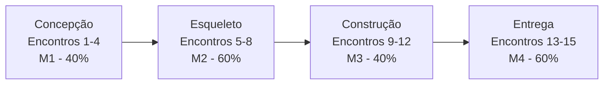

<div align="center">

# 🚗 AutoSaller — Sistema de Gestão de Vendas de Automóveis

**Um Sistema, duas disciplinas.** Documentação pensada para orientar o time do começo ao fim do semestre.

</div>

**Equipe:** Ingridy Luzia · José Henrique · Maycon Douglas · Nicole Gabriel · Paulo Guilherme
**Curso:** Tecnologia em Sistemas para Internet (TSI) — IFRN, Campus Currais Novos
**Período:** 09/09/2026 a 09/12/2026 (13 semanas)

---

## 🧭 Índice

1. [Por que AutoSaller?](#-Por-que-AutoSaller)
2. [O sistema em uma frase](#-o-sistema-em-uma-frase)
3. [Escopo: o que entra e o que não entra](#-escopo-o-que-entra-e-o-que-não-entra)
4. [Requisitos por prioridade](#-requisitos-por-prioridade)
5. [Cronograma: marcos e janelas de entrega](#-cronograma-marcos-e-janelas-de-entrega)
6. [Ordem de construção: fatias verticais](#-ordem-de-construção-fatias-verticais)
7. [Permissões por perfil](#-permissões-por-perfil)
8. [Modelo de dados](#-modelo-de-dados)
9. [Checklist mínimo das duas disciplinas](#-checklist-mínimo-das-duas-disciplinas)
10. [Rubrica de Sistemas Corporativos (50 pts)](#-rubrica-de-sistemas-corporativos-50-pts)
11. [Requisitos não funcionais: onde comprovar](#-requisitos-não-funcionais-onde-comprovar)
12. [Estrutura do repositório](#-estrutura-do-repositório)
13. [Fluxo de trabalho no Git](#-fluxo-de-trabalho-no-git)
14. [Erros que reprovam o grupo](#-erros-que-reprovam-o-grupo)
15. [Decisões e pendências](#-decisões-e-pendências)
16. [Documentação e referências](#-documentação-e-referências)

---

## 📌 Por que AutoSaller?

O **AutoSaller** foi criado para atender as necessidades do mercado de automóveis local de Currais Novos. O "Auto" refere-se aos automóveis e "Seller" refere-se ao vendedor ou lojista, o objetivo principal é satisfazer as necessidades de um mercado em crescente desenvolvimento e expansão ao longo prazo.


Sendo assim, a fim de satisfazer os requisitos das disciplinas, durante o desenvolvimento foi visado um sistema completo, ponta-a-ponta, guiado por três âncoras — **Banco de Dados**, **Sistemas Corporativos** e **Processo de Desenvolvimento** — estes avaliados em 4 marcos (M1–M4) com Sistemas Corporativos sendo uma dessas âncoras com sua rubrica própria.

> **PoC vs. MVP vs. Product** (contexto rápido)
> - **PoC** — "isso é possível?" → protótipo descartável, só valida a ideia.
> - **MVP** — "isso resolve o problema de alguém?" → é o que o AutoSaller precisa ser até o M3.
> - **Product** — "isso se sustenta e escala?" → fora do escopo deste semestre.

---

## 🎯 O sistema em uma frase

Centralizar em uma aplicação web o processo de venda de veículos de uma concessionária, com dois perfis de acesso (**Administrador** e **Vendedor**) e 5 módulos integrados: **Vendas · Estoque · Clientes · Relatórios · Usuários**.

**Stack:** NestJS + PostgreSQL (back-end) · VueJS + TypeScript (front-end)

### Cadastro de veículos

O cadastro de veículos está disponível para administradores na interface web. Após entrar com CPF e senha, o administrador informa marca, modelo, versão, ano, cor, quilometragem, combustível, câmbio, placa, chassi, RENAVAM e preço. A API recebe o cadastro em `POST /veiculos` com token Bearer de administrador e valida os dados, impedindo a repetição de placa, chassi ou RENAVAM.

### Listagem do estoque

A mesma tela de **Estoque de Veículos** é acessível a administradores (`/admin/veiculos`) e vendedores (`/vendedor/veiculos`). A consulta usa `GET /veiculos`, protegida por JWT e pelos perfis `admin` e `vendedor`; os parâmetros opcionais `marca`, `modelo`, `precoMin`, `precoMax`, `anoMin`, `anoMax`, `combustivel` e `status` são combinados na consulta ao banco. O endpoint retorna apenas os campos necessários à listagem. Os status válidos são `disponivel`, `reservado`, `vendido` e `em_manutencao`. A entidade de veículos ainda não possui campo de foto, portanto a interface não exibe uma imagem fictícia.

Administradores podem alterar entre `disponivel` e `em_manutencao` pela listagem, após confirmação; vendedores apenas consultam os status. `PATCH /veiculos/:id/status` é protegido no backend e não permite alterar manualmente estados de reserva ou venda nem veículos com venda concluída. A tela administrativa também consulta `GET /veiculos/estoque/resumo` e configura o limite por `PATCH /veiculos/estoque/minimo`; a quantidade disponível considera somente veículos com status `disponivel`, e o limite inicial é 10. O sistema ainda não possui cadastro ou cancelamento de reservas, portanto o estado `reservado` permanece bloqueado para alteração manual até que exista um processo próprio.

**Documentos-base do projeto:**

| Documento | Onde está | Situação |
|---|---|---|
| Requisitos de Software (BRD) | [`docs/analise-de-requisitos.md`](docs/analise-de-requisitos.md) | v1.0 de 20/09/2026 · 49 requisitos funcionais e 10 não funcionais |
| Cronograma e requisitos priorizados | [`docs/cronograma.md`](docs/cronograma.md) | Janelas de 09/09 a 09/12 |
| Diagrama de Entidade-Relacionamento | [dbdiagram](https://dbdiagram.io/d/Diagrama-DER-AutoSeller-6ab184d19ba2420e18d47abd) · cópia em `docs/modelo-de-dados/` | 7 tabelas |
| Diagrama de Casos de Uso | `docs/casos-de-uso/` | Administrador e Vendedor |

> **Nomenclatura:** o "Módulo de Veículos" do Cronograma é o módulo **Estoque** do BRD e deste README (`modules/estoque`).

---

## 📦 Escopo: o que entra e o que não entra

| ✅ Dentro do escopo | 🚫 Fora do escopo |
|---|---|
| **Estoque:** cadastro, edição, consulta e status de veículos, com validações e alerta visual de estoque mínimo | **Integração com DETRAN/SENATRAN:** chassi e RENAVAM são apenas simulados |
| **Vendas:** registro (veículo + cliente + vendedor), baixa automática de estoque, comissão e desconto especial (≥ 10%) com aprovação do Administrador | **Nota fiscal eletrônica:** nenhuma integração com Receita Federal ou SEFAZ |
| **Clientes:** CRUD com validação e agendamento/cancelamento de test drive | **Hospedagem paga e domínio próprio:** roda em `localhost` ou em nuvem gratuita, só para demonstração |
| **Usuários:** login, perfis Administrador/Vendedor, inativação de contas e log de auditoria | **Aplicativo mobile nativo:** só interface web responsiva |
| **Relatórios:** faturamento por período, vendas por vendedor e posição do estoque, em tela e exportáveis (PDF/CSV) | **Gateway de pagamento real:** o pagamento é simulado no banco |
| **Documentação acadêmica:** BRD, DER, casos de uso, prototipagem e ambiente de demonstração para a banca | **Requisitos "Não terá":** RF-REL-07 (envio mensal por e-mail) e RF-REL-08 (projeção de vendas com IA) |

---

## 📋 Requisitos por prioridade

Escala do BRD: **1 Obrigatório** (sem ele o projeto não existe) · **2 Desejável** (dá valor; o MVP sobrevive sem) · **3 Opcional** · **4 Não terá**.

| Módulo | 1 · Obrigatório | 2 · Desejável | 3 · Opcional | 4 · Não terá |
|---|---|---|---|---|
| **Vendas** (7) | VEN-01, 02, 03, 06 | VEN-04, 05, 07 | — | — |
| **Estoque** (7) | EST-01, 02, 03 | EST-04, 06 | EST-05 e EST-07 | — |
| **Clientes** (11) | CLI-01, 02, 03, 05, 06, 11 | CLI-04, 07, 10 | CLI-08, 09 | — |
| **Relatórios** (8) | REL-01, 02, 03 | REL-04, 05 | REL-06 | REL-07, 08 |
| **Usuários** (16) | USU-01, 02, 03, 04, 08, 09, 10, 11, 14, 15, 16 | USU-06, 07, 12, 13 | USU-05 | — |

> - **RF-EST-05 e RF-EST-07 descrevem o mesmo alerta de estoque mínimo** — tratar como um requisito só.
> - A maior parte dos RF-USU-01 a 14 descreve, pela ótica do perfil, funções que já pertencem a outros módulos (registrar venda, cadastrar cliente ou veículo, aprovar desconto). Eles viram a [matriz de permissões](#-permissões-por-perfil), aplicada por *guards*.

---

## 📅 Cronograma: marcos e janelas de entrega



| Bloco | Encontros | Marco | O que a banca espera | O que isso é no AutoSaller |
|---|---|---|---|---|
| 📋 Concepção | 1–4 | **M1** — Proposta do Projeto | Documento + pitch, escopo mínimo, orientador aceito, backlog, modelo de dados preliminar | **Já temos:** BRD v1.0, escopo dentro/fora, requisitos priorizados de 1 a 4, DER, casos de uso e cronograma com datas. **Falta:** orientador definido, diagrama de classes e repositório inicializado (NestJS + Vue) |
| 🏗️ Esqueleto | 5–8 | **M2** — PoC ponta a ponta | Fluxo completo: tela → regra → banco → resposta, ao vivo | Ambiente montado e a 1ª fatia no ar **por URL**: login com 2 perfis e log de auditoria |
| 🔧 Construção | 9–12 | **M3** — MVP em homologação | Autenticação, 2 perfis, CRUDs centrais, consulta consolidada, dados de exemplo | Clientes, Estoque e Vendas funcionando de ponta a ponta + relatório consolidado, com dados de exemplo |
| 🚀 Entrega | 13–15 | **M4** — Entrega final e banca | Sistema publicado por URL, relatório técnico ABNT, apresentação e arguição individual | Deploy final, relatório escrito, defesa de cada integrante |

Janelas de entrega do Cronograma (09/09 a 09/12):

| Janela | Fase | O que o Cronograma prevê |
|---|---|---|
| 09/09 – 27/09 | Requisitos e arquitetura | Requisitos e casos de uso, DER, diagrama de classes, repositório com projeto NestJS, projeto Vue responsivo |
| 28/09 – 12/10 | **Fatia 1** — Usuários | Login com senha em hash, perfis e permissões, tabela e rotina de log de auditoria, telas de login/logout e navegação protegida, gestão e inativação de usuários, consulta ao log |
| 13/10 – 24/10 | **Fatia 2** — Clientes | CRUD e validações, inativação lógica, agendamento/cancelamento de test drive, telas |
| 25/10 – 05/11 | **Fatia 3** — Estoque | CRUD de veículos, controle de status, filtros e validações (placa, chassi, RENAVAM), listagem com alerta de estoque mínimo |
| 06/11 – 20/11 | **Fatias 4 e 5** — Vendas | Registro de venda, baixa automática, comissão, fluxo de desconto especial, formulários e interfaces |
| 21/11 – 30/11 | **Fatia 6** — Relatórios | Faturamento, posição do estoque, desempenho por vendedor, exportação PDF/CSV, tela com filtros |
| 01/12 – 09/12 | Testes e documentação | Usabilidade, desempenho, responsividade, publicação em nuvem gratuita, relatório técnico, roteiro da demonstração |

> As datas de M1–M4 ainda precisam ser confirmadas com o calendário da disciplina: são 13 semanas de calendário para 15 encontros. Veja as [pendências](#-decisões-e-pendências).
> **Deploy e testes não esperam dezembro:** o Cronograma prevê publicação e testes só em 01/12–09/12, mas cada fatia precisa estar no ar por URL (M2 em diante), então o primeiro deploy sai com a fatia 1 e cada fatia entrega os seus testes.

---

## 🧩 Ordem de construção: fatias verticais

O maior risco de "sistema complexo demais" é dividir o trabalho **por camada** (uma pessoa só no front, outra só no banco) — sem ninguém integra nada até a última semana. A saída é dividir **por fatia vertical**: cada entrega atravessa banco → back-end → front-end e já sobe para o ar, mesmo que pequena.

A ordem abaixo segue as janelas do Cronograma, e cada fatia tem um responsável natural: quem escreveu os requisitos daquele módulo.

| # | Fatia | Janela | O que sobe ao ar | Requisitos atendidos | Responsável |
|---|---|---|---|---|---|
| 1 | Usuários, autenticação e auditoria | 28/09 – 12/10 | Login com hash, 2 perfis com *guards*, cadastro e bloqueio de funcionários, log de auditoria gravado por interceptor e tela de consulta ao log | RF-USU-09, 15, 16 · RNF004, 005, 006, 007 | Paulo Guilherme |
| 2 | Clientes | 13/10 – 24/10 | CRUD com validação, inativação lógica, acesso restrito aos dados; test drive *(cortável)* | RF-CLI-01 a 06, 11 · RF-CLI-08/09 e RF-USU-05 *(test drive)* | Nicole Gabriel |
| 3 | Estoque | 25/10 – 05/11 | Cadastro, consulta e edição, status (Disponível/Reservado/Vendido/Em Manutenção), validação de placa/chassi/RENAVAM, filtros, histórico de entradas e saídas, alerta de estoque mínimo *(cortável)* | RF-EST-01 a 07 · RF-USU-11 | Maycon Douglas |
| 4 | Vendas — núcleo | 06/11 – 20/11 | Registrar venda (veículo + cliente + vendedor), pagamento, baixa automática de estoque **na mesma transação**, comissão, histórico de vendas | RF-VEN-01 a 04, 06 | Ingridy Luzia |
| 5 | Vendas — desconto especial e cancelamento | 06/11 – 20/11 | Solicitação de desconto ≥ 10%, aprovação/reprovação pelo Administrador, cancelamento de venda com justificativa no log | RF-VEN-05, 07 · RF-USU-06, 12 | Ingridy Luzia · Paulo Guilherme |
| 6 | Relatórios consolidados | 21/11 – 30/11 | Faturamento, posição de estoque, desempenho por vendedor (join de +1 tabela), consolidado do Administrador, relatório e comissões do próprio vendedor, exportação PDF/CSV *(cortável)* | RF-REL-01 a 05 · RF-USU-03, 07, 10 | José Henrique |

- **Depois de Vendas:** RF-CLI-07 (histórico de compras) e RF-CLI-10 (pós-venda e garantia) dependem das vendas registradas.
- **Fatia 6:** resolve, sozinha, a exigência de "consulta/relatório que agregue dados de mais de uma tabela" das duas disciplinas. Vale ir escrevendo as consultas sobre os dados de exemplo antes da janela de 21/11.
- **Ordem de corte se o prazo apertar** (nunca os de prioridade 1), sugestão: RF-REL-06 (dashboard gráfico, fora do Cronograma) → test drive (RF-CLI-08/09, RF-USU-05) → alerta de estoque mínimo (RF-EST-05/07) → exportação PDF/CSV (RF-REL-04).

---

## 🔐 Permissões por perfil

| Vendedor pode | Administrador pode |
|---|---|
| Cadastrar cliente (RF-USU-01) | Cadastrar veículos e alterar o status (RF-USU-08, 14) |
| Registrar venda de veículo disponível (RF-USU-02) | Cadastrar vendedores e bloquear o acesso sem apagar o histórico (RF-USU-09, 15) |
| Consultar veículos disponíveis (RF-USU-04) | Aprovar ou reprovar desconto ≥ 10% (RF-USU-12) |
| Ver o próprio relatório de vendas por período e as comissões do mês (RF-USU-03, 07) | Aprovar alteração de dados de veículos, clientes e vendedores (RF-USU-13) |
| Agendar, cancelar e atualizar test drive (RF-USU-05) | Cancelar venda, com justificativa no log (RF-VEN-07) |
| Solicitar desconto ≥ 10% (RF-USU-06) | Ver relatórios consolidados por mês ou vendedor e o histórico de entradas e saídas de veículos (RF-USU-10, 11) |
| | Consultar o log de auditoria |

O sistema registra **log de auditoria** (data, hora e usuário) em toda alteração crítica de dados (RF-USU-16).

> **RNF005:** vendedor não acessa funções administrativas nem por URL direta. Isso se valida no **back-end** (*guards* por perfil), não apenas escondendo botões no front.

---

## 💾 Modelo de dados

O DER tem **7 tabelas**, mais que o mínimo de 3 entidades relacionadas exigido pelas disciplinas:

| Tabela | Módulo | O que guarda |
|---|---|---|
| `USUARIO` | Usuários | Nome, CPF, senha (hash), perfil, ativo |
| `CLIENTE` | Clientes | Dados pessoais e de contato, documento, campo `ativo` para inativação |
| `VEICULO` | Estoque | Marca, modelo, versão, ano, cor, km, combustível, câmbio, placa, chassi, RENAVAM, preço, status, data de entrada |
| `VENDA` | Vendas | Cliente, veículo e vendedor; valores, desconto, forma e condições de pagamento, comissão, status |
| `DESCONTO` | Vendas | Solicitação e aprovação de desconto: venda, vendedor, administrador, percentual, justificativa, status |
| `TEST_DRIVE` | Clientes | Cliente, veículo e vendedor, data e hora, status |
| `LOG_AUDITORIA` | Usuários / `common` | Autor, ação, recurso afetado, motivo, detalhes (JSON) |

O diagrama está no [dbdiagram](https://dbdiagram.io/d/Diagrama-DER-AutoSeller-6ab184d19ba2420e18d47abd). Mantenha também uma cópia versionada (DBML ou PNG) em `docs/modelo-de-dados/`, para o repositório não depender de um link externo.

---

## ✅ Checklist mínimo das duas disciplinas

- [ ] Domínio delimitado e usuário identificável — concessionária / Administrador & Vendedor
- [ ] Consulta ou relatório que agregue dados de mais de uma tabela — RF-REL-01/02/03
- [ ] Cadastro e autenticação com pelo menos dois perfis — RF-USU-09/15, RNF004, RNF005
- [ ] Pelo menos 3 entidades relacionadas com integridade referencial — o DER tem 7 (Usuário, Cliente, Veículo, Venda, Desconto, Test Drive, Log de Auditoria)
- [ ] Fluxo principal ("caminho feliz") completo, sem erros — login → registrar venda → baixa de estoque → aparece no relatório
- [ ] CRUD completo (criar, listar, editar, remover) sobre as entidades centrais — Estoque e Clientes. **"Remover" = inativação lógica** (RF-CLI-04); para veículos, ver [pendências](#-decisões-e-pendências)
- [ ] Validação de dados e tratamento de erro visível ao usuário — RF-EST-04, RF-CLI-05
- [ ] Repositório Git com histórico distribuído entre os 5 integrantes
- [ ] Sistema implantado e acessível por URL, com dados de exemplo carregados
- [ ] Relatório técnico em normas ABNT

---

## 📊 Rubrica de Sistemas Corporativos (50 pts)

| Critério | Pontos | O que no AutoSaller comprova isso |
|---|---:|---|
| Domínio, requisitos e valor corporativo | 8 | BRD — descrição, escopo, 3 direcionadores de negócio, processo sem e com software, RFs priorizados e casos de uso |
| Arquitetura, modularidade e decisões registradas | 10 | Camadas no NestJS (controller/service/repository), 5 módulos desacoplados (RNF010), decisões registradas em `docs/decisoes-arquiteturais/` |
| Segurança, dados, transações e auditoria | 8 | Senhas com hash (RNF004), controle por perfil (RNF005), dados de clientes restritos (RNF006, RF-CLI-11), log de auditoria (RNF007, RF-USU-16), venda + baixa de estoque em **uma única transação** de banco |
| Integração, resiliência e observabilidade | 8 | Módulos integrados em tempo real (venda → baixa automática de estoque), tratamento de erro visível, consultas em até 2 s (RNF003), disponibilidade na demonstração (RNF008). *Sugestão para observabilidade:* logs de aplicação e um endpoint de saúde |
| Testes, CI, contêineres e execução reproduzível | 6 | Testes automatizados a cada fatia, Docker Compose, pipeline simples de CI |
| Documentação, demonstração e defesa | 10 | Este README + relatório ABNT + apresentação final |

> **Regras que valem nota nessa disciplina:** todo mundo do grupo precisa dominar a solução inteira **(a defesa é individual e pode ajustar a nota)**; código ou texto de terceiros usado precisa ser identificado e devidamente referenciado; a entrega precisa incluir instruções reproduzíveis e histórico de versão real.

---

## 🧱 Requisitos não funcionais

| RNF | Exigência | Onde se comprova |
|---|---|---|
| RNF001 | Interface web responsiva (computador, notebook, tablet) | Front Vue responsivo desde a fatia 1; ajustes finais em 01/12–09/12 |
| RNF002 | Registrar venda em no máximo 4 etapas/cliques após escolher o veículo | Formulário de venda (fatia 4) |
| RNF003 | Consultas de estoque e relatórios simples em até 2 s | Teste de desempenho com dados de exemplo |
| RNF004 | Senhas criptografadas (hash) | Fatia 1 |
| RNF005 | Acesso por perfil, inclusive por URL direta | *Guards* no back-end, fatia 1 |
| RNF006 | Dados de clientes visíveis e editáveis só por usuários autorizados (LGPD simplificada) | RF-CLI-11, fatia 2 |
| RNF007 | Log com data, hora, ID do usuário e ação em alterações críticas | Fatia 1, com RF-USU-16 |
| RNF008 | Disponibilidade de 99% em `localhost` ou nuvem gratuita durante testes e apresentação | Deploy antecipado (M2 em diante) |
| RNF009 | Chrome, Firefox, Edge e Safari | Teste manual antes de cada marco |
| RNF010 | Código modular e documentado | Módulos NestJS + decisões arquiteturais |

---

## 📁 Estrutura do repositório

Um **monorepo único** (um repositório só, com back-end, front-end e documentação juntos) é a dexisão ideal para um time de 5 pessoas com 3 meses de desenvolvimento apenas. Evita sincronizar múltiplos repositórios e mantém num só lugar o histórico de commits que as disciplinas exigem.

```
autosaller/
├── backend/                       # API NestJS
│   ├── src/
│   │   ├── modules/
│   │   │   ├── auth/               # Login e perfis (fatia 1)
│   │   │   ├── usuarios/           # Funcionários e consulta ao log (fatia 1)
│   │   │   ├── clientes/           # Clientes e test drive (fatia 2)
│   │   │   ├── estoque/            # Veículos (fatia 3)
│   │   │   ├── vendas/             # Vendas, descontos e cancelamento (fatias 4 e 5)
│   │   │   └── relatorios/         # Relatórios (fatia 6)
│   │   ├── common/                 # guards de perfil, interceptor de auditoria, filtros de erro
│   │   └── database/               # migrations e seeds (dados de exemplo)
│   └── test/
├── frontend/                       # VueJS + TypeScript
│   └── src/
│       ├── views/                   # uma pasta por módulo, espelhando o backend
│       ├── components/
│       └── services/                 # chamadas à API
├── docs/
│   ├── analise-de-requisitos.md     # o BRD (v1.0)
│   ├── cronograma.md                # cronograma com datas e requisitos priorizados
│   ├── modelo-de-dados/             # DER: DBML/PNG + link do dbdiagram
│   ├── casos-de-uso/                # diagrama de casos de uso
│   ├── diagrama-de-classes/         # previsto no Cronograma
│   ├── decisoes-arquiteturais/      # decisões curtas, uma por arquivo
│   └── relatorio-final-abnt.pdf
├── .github/
│   └── workflows/                    # CI: lint + testes a cada push
├── docker-compose.yml                # único, na raiz: sobe backend + frontend + banco juntos
└── README.md                         # este arquivo
```

Cada módulo do `backend/modules` e do `frontend/views` espelha um bloco de requisitos (RF-EST, RF-CLI, RF-VEN...) e um responsável da tabela de fatias acima — assim fica claro quem mexe onde e os conflitos de merge diminuem. A auditoria é transversal: um interceptor em `common/` grava em `LOG_AUDITORIA`, então cada módulo herda o log em vez de reimplementá-lo.

---

## 🌿 Fluxo de trabalho esperado no Git

- `main` — sempre estável e implantável, só recebe merge via Pull Request.
- `dev` — branch de integração; cada fatia é mesclada aqui antes de ir para `main`.
- `feature/<módulo>-<tarefa>` — uma branch por tarefa (ex.: `feature/estoque-cadastro`).
- Commits pequenos e frequentes, de cada integrante — o histórico do Git é evidência de trabalho real; commit em massa na véspera do marco é o oposto disso.
- Pull Request obrigatório antes de mesclar em `dev`, com pelo menos uma revisão de outro integrante.

---

## 🚨 Erros que reprovam o grupo!

- **Dividir por camada em vez de por fatia** — um só no front, outro só no back, outro só no banco. Ninguém integra até a última semana, e nada encaixa.
- **Sumir e reaparecer no fim** — o histórico do Git mostra tudo; commit em massa na véspera é evidência contra o grupo, não trabalho.
- **Deixar módulos desintegrados** — cada fatia só conta se atravessar banco → back → front e estiver acessível por URL.
- **Deixar deploy e testes para dezembro** — publicar só em 01/12 esconde problemas de ambiente até a semana da banca. O primeiro deploy sai com a fatia 1.
- **Deixar a auditoria para o fim** — cancelamento de venda e aprovação de desconto precisam gravar no log; sem o interceptor pronto, cada módulo acaba com uma solução própria.

---

## 📝 Decisões e pendências

### Decisões registradas

| Tema | Decisão | Observação |
|---|---|---|
| Desconto especial | Vale a partir de **≥ 10%** | Conforme RF-VEN-05, RF-USU-06 e RF-USU-12. O escopo do BRD, o fluxograma do processo proposto e o Cronograma dizem "> 10%" e devem ser corrigidos. Testar o limite em exatamente 10% |
| Test drive e exportação PDF/CSV | No escopo, mas **cortáveis** | Ficam no escopo do BRD, no caso de uso e no Cronograma; prioridade 3 (test drive) e 2 (exportação) |
| Ordem das fatias | Usuários → Clientes → Estoque → Vendas → Relatórios | Segue o Cronograma |
| Auditoria | Sobe com a fatia 1 | RF-USU-16 é prioridade 1 e as fatias seguintes gravam no log |
| "Remover" no CRUD | Inativação lógica | RF-CLI-04 e Cronograma; o escopo do BRD fala em "Deletar" |
| Deploy e testes | Contínuos, desde a fatia 1 | O Cronograma só os prevê em 01/12–09/12 |
| Nomes e duplicatas | Estoque = "Módulo de Veículos"; RF-EST-05 = RF-EST-07 | |

### Pendências em aberto

- [ ] **Orientador** do projeto (exigido no M1).
- [ ] **Grafia do nome:** AutoSaller (este README) × AutoSeller (BRD, DER e casos de uso).
- [ ] **Datas dos marcos** M1–M4 e o que os percentuais 40/60/40/60 ponderam.
- [ ] **Plataforma de deploy** que rode NestJS + PostgreSQL no plano gratuito (o BRD cita Render, Vercel e Supabase).
- [ ] **Identificador de login:** no DER, `USUARIO` tem CPF e senha, sem e-mail ou nome de usuário.
- [ ] **Remoção de veículo:** não há RF. Proposta: exclusão lógica, prioridade 2.
- [ ] **RF-USU-11 (entradas e saídas de veículos):** o DER só tem `data_entrada` e status no veículo. Definir se o histórico deriva do log ou ganha tabela de movimentação.
- [ ] **RF-CLI-10 (pós-venda e garantia):** o DER não tem campos de garantia.
- [ ] **Cronograma:** acrescentar RF-VEN-03, RF-VEN-06, RF-USU-11, RF-USU-03/07, RF-VEN-07, RF-CLI-07, RF-USU-13 e RF-REL-05; incluir testes automatizados, Docker Compose, CI, decisões arquiteturais e dados de exemplo; remover as duas linhas repetidas em Clientes.
- [ ] **BRD:** trocar "> 10%" por "≥ 10%"; unificar RF-EST-05 e RF-EST-07; rever o direcionador 3 (margem por veículo), já que o DER não guarda custo.

---

## 📚 Documentação e referências

- [Documento de Requisitos de Software (BRD)](docs/analise-de-requisitos.md) — descrição completa, escopo, requisitos funcionais (RF-VEN, RF-EST, RF-CLI, RF-REL, RF-USU) e não funcionais (RNF001–010)
- [Cronograma do Projeto Integrador I](docs/cronograma.md) — requisitos priorizados e janelas de entrega
- [DER no dbdiagram](https://dbdiagram.io/d/Diagrama-DER-AutoSeller-6ab184d19ba2420e18d47abd)
- [Documentação NestJS](https://docs.nestjs.com/)
- [Documentação Node.js](https://nodejs.org/docs/latest/api/)
- [Documentação PostgreSQL 17](https://www.postgresql.org/docs/17/index.html)
- [Documentação VueJS](https://vuejs.org/guide/introduction.html)
- [Documentação TypeScript](https://www.typescriptlang.org/pt/docs/)
- [Documentação HTML5](https://developer.mozilla.org/pt-BR/docs/Web/HTML) · [Documentação CSS3](https://developer.mozilla.org/pt-BR/docs/Web/CSS)
- [Documentação DBeaver](https://dbeaver.com/docs/dbeaver/) · [Documentação Visual Studio Code](https://code.visualstudio.com/docs)