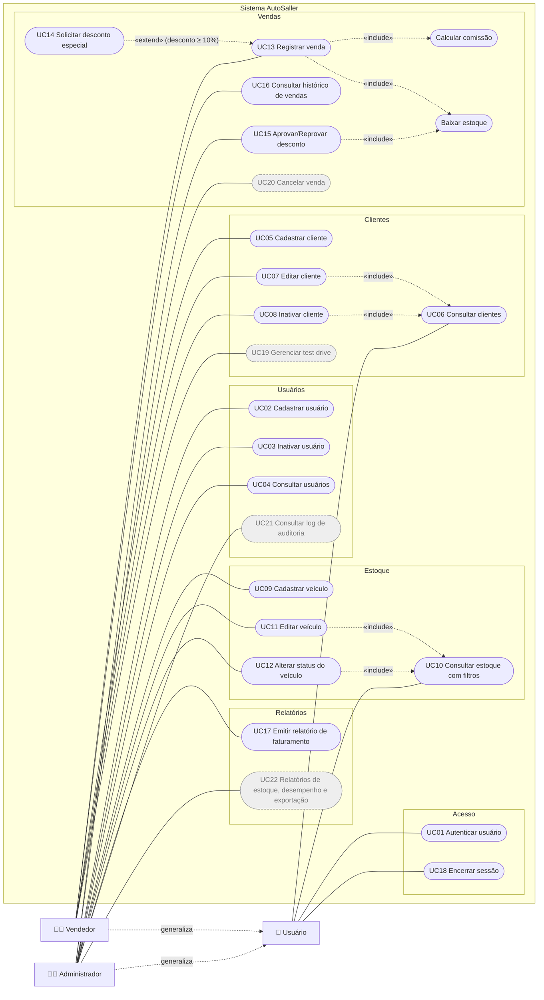

# 1. Casos de Uso — AutoSaller

## 1.1 Atores

| Ator | Tipo | Descrição | Como é identificado no sistema |
|---|---|---|---|
| **Usuário** | Primário (abstrato) | Generalização de qualquer funcionário com conta ativa. Herda os casos de uso comuns (autenticar, encerrar sessão, consultar estoque e clientes). | Linha em `usuarios` com `ativo = true` |
| **Vendedor** | Primário | Atende clientes, consulta o estoque e registra vendas. Pode solicitar desconto especial. | `usuarios.perfil = 'vendedor'` (claim `perfil` do JWT) |
| **Administrador** | Primário | Gestor da concessionária: cadastra funcionários e veículos, aprova descontos, acompanha relatórios. Também pode realizar tudo o que o vendedor realiza. | `usuarios.perfil = 'admin'` |
| **Relógio do sistema** | Secundário | Expiração do token de acesso (`JWT_EXPIRES_IN_SECONDS`, padrão 900 s). | Claim `exp` do JWT |

> **Generalização:** Vendedor e Administrador especializam Usuário. A matriz de permissões é aplicada no **backend** por `JwtAuthGuard` + `RolesGuard` (RNF005) e repetida no **frontend** pelos *guards* do Vue Router apenas para usabilidade.

## 1.2 Diagrama de casos de uso

O Mermaid não possui notação UML nativa de casos de uso; a convenção adotada é: atores como nós retangulares fora da fronteira, casos de uso como elipses (estádio) dentro do subgrafo **Sistema AutoSaller**, associações como linhas contínuas e relacionamentos `«include»`/`«extend»` como setas tracejadas rotuladas. Casos de uso planejados estão em cinza.

> **Leitura do diagrama.** O Administrador também executa os casos de uso associados ao Vendedor (UC05, UC07, UC08, UC13, UC16), porque os endpoints aceitam os dois perfis; as setas foram omitidas para não poluir o diagrama. No UC13, se o Administrador aplicar desconto ≥ 10%, a venda é concluída diretamente (o UC14 só estende o UC13 quando o ator é Vendedor).

### Matriz ator × caso de uso (como implementado na API)

| Caso de uso | Endpoint | Vendedor | Administrador |
|---|---|:---:|:---:|
| UC01 Autenticar | `POST /auth/login`, `GET /auth/perfil` | ✔ | ✔ |
| UC02 Cadastrar usuário | `POST /usuarios` | ✘ (403) | ✔ |
| UC03 Inativar usuário | `PATCH /usuarios/:id/inativar` | ✘ (403) | ✔ |
| UC04 Consultar usuários | `GET /usuarios`, `GET /usuarios/:id` | ✘ (403) | ✔ |
| UC05–UC08 Clientes | `/clientes/**` | ✔ | ✔ |
| UC09 Cadastrar veículo | `POST /veiculos` | ✔ ⚠ DEF-04 | ✔ |
| UC10 Consultar estoque | `GET /veiculos`, `GET /veiculos/:id` | ✔ | ✔ |
| UC11 Editar veículo | `PATCH /veiculos/:id` | ✔ ⚠ DEF-04 | ✔ |
| UC12 Alterar status | `PATCH /veiculos/:id/status` | ✔ ⚠ DEF-04 | ✔ |
| UC13/UC14 Registrar venda / desconto | `POST /vendas` | ✔ | ✔ |
| UC15 Aprovar/reprovar desconto | `PATCH /vendas/:id/aprovar`, `/rejeitar` | ✘ (403) | ✔ |
| UC16 Histórico de vendas | `GET /vendas`, `GET /vendas/:id` | ✔ | ✔ |
| UC17 Faturamento | `GET /relatorios/faturamento` | ✔ | ✔ |

⚠ = diverge do requisito: RF-USU-08 e RF-USU-14 atribuem essas ações apenas ao Administrador. A tela já esconde os botões para o vendedor, mas a API aceita a chamada direta.

---

## 1.3 Especificação dos casos de uso

Formato de cada especificação: identificação, pré-condições, fluxo principal (FP), fluxos alternativos (FA) e de exceção (FE), pós-condições e regras de negócio (RN). Os passos citam a camada responsável entre colchetes: **[F]** frontend, **[B]** backend, **[BD]** banco.

### UC01 — Autenticar usuário ✅

| Campo | Descrição |
|---|---|
| **Atores** | Usuário (Vendedor ou Administrador) |
| **Requisitos** | RNF004 (hash), RNF005 (acesso por perfil), RF-USU-15 (bloqueio) |
| **Pré-condições** | Usuário cadastrado e ativo. |
| **Gatilho** | Usuário acessa `/` (tela de login) ou uma rota protegida sem sessão. |

**Fluxo principal**
1. [F] O sistema exibe o formulário com **CPF** e **Senha**.
2. O usuário informa CPF e senha e aciona **Entrar**.
3. [F] O sistema valida o CPF pelos dígitos verificadores e exige senha não vazia.
4. [F] O sistema remove a máscara do CPF e envia `POST /auth/login {cpf, senha}`.
5. [B] `LocalStrategy` busca o usuário pelo CPF (selecionando o hash) e compara a senha com `bcrypt.compare`.
6. [B] O sistema assina um JWT com `sub`, `cpf`, `perfil` e `nome`, válido por 900 s, e responde `{ accessToken }`.
7. [F] O sistema guarda o token em `sessionStorage`, chama `GET /auth/perfil` e carrega o perfil na *store* Pinia.
8. [F] O sistema redireciona: Administrador → `/dashboard`; Vendedor → `/vendedor`; ou, se existir, para o parâmetro `redirect` (somente caminhos internos que começam com `/` e não com `//`).

**Fluxos alternativos e de exceção**
- **FE1 – CPF inválido (passo 3):** o sistema exibe “Informe um CPF válido.” e não envia a requisição.
- **FE2 – Credenciais incorretas ou usuário inativo (passo 5):** a API responde `401 Credenciais inválidas`, e a tela mostra “CPF ou senha inválidos…”. A mensagem não revela qual dos dois falhou nem se a conta está bloqueada.
- **FE3 – Falha de rede/servidor:** o sistema exibe “Não foi possível concluir o acesso. Tente novamente.”
- **FA1 – Usuário já autenticado acessa `/`:** o sistema redireciona para o painel do perfil.
- **FA2 – Token expirado durante o uso:** `GET /auth/perfil` responde 401; o sistema encerra a sessão (UC18) e volta ao login.

**Pós-condições:** existe um JWT válido no `sessionStorage` da aba; o perfil define os menus e as rotas acessíveis.

**Regras de negócio**
- **RN01:** a senha nunca é armazenada nem comparada em texto puro (bcrypt, custo 10).
- **RN02:** um usuário inativo não autentica, mas o histórico dele é preservado.

### UC02 — Cadastrar usuário ✅

| Campo | Descrição |
|---|---|
| **Atores** | Administrador |
| **Requisitos** | RF-USU-09 |
| **Pré-condições** | Administrador autenticado (UC01). |

**Fluxo principal**
1. O Administrador abre **Usuários → Cadastrar**.
2. Informa nome, CPF, senha (mínimo 6 caracteres) e perfil (Administrador ou Vendedor).
3. [F] O sistema envia `POST /usuarios`.
4. [B] O `ValidationPipe` valida o DTO: CPF com 11 dígitos e perfil ∈ {admin, vendedor}.
5. [B] O sistema gera o hash da senha, cria o usuário com `ativo = true` e responde 201 sem o campo `senha`.
6. [F] O sistema exibe a confirmação e atualiza a lista.

**Fluxos alternativos e de exceção**
- **FE1 – Dados inválidos:** a API responde 400 com a lista de mensagens, e a tela as exibe.
- **FE2 – CPF já cadastrado:** a resposta esperada é 409, mas hoje a API responde **500** (violação de UNIQUE não tratada, **DEF-05**).
- **FE3 – Vendedor tenta acessar:** o *guard* do frontend redireciona; a API responde 403.

**Pós-condições:** o novo usuário pode autenticar (UC01).

### UC03 — Inativar usuário ✅

| Campo | Descrição |
|---|---|
| **Atores** | Administrador |
| **Requisitos** | RF-USU-15 |
| **Pré-condições** | Administrador autenticado; usuário-alvo ativo. |

**Fluxo principal**
1. O Administrador abre **Inativar usuário** e localiza o funcionário por nome ou CPF (apenas ativos são listados).
2. Seleciona o funcionário; o sistema abre um diálogo pedindo que **redigite o CPF** como confirmação.
3. [F] Com o CPF conferido, o sistema envia `PATCH /usuarios/:id/inativar {cpf}`.
4. [B] O sistema localiza o usuário por **id e CPF** simultaneamente, define `ativo = false` e devolve o usuário sem senha.

**Fluxos alternativos e de exceção**
- **FE1 – Id e CPF não correspondem:** 404 “Usuario não encontrado”.
- **FE2 – Usuário já inativo:** 409 “Usuario já está inativo”.

**Pós-condições:** o usuário não consegue mais autenticar; as vendas dele continuam no histórico, porque a inativação é lógica.

**Regras de negócio**
- **RN03:** não há exclusão física de funcionários.

### UC04 — Consultar usuários ✅

| Campo | Descrição |
|---|---|
| **Atores** | Administrador |
| **Pré-condições** | Administrador autenticado. |

**Fluxo principal**
1. O Administrador abre **Usuários**.
2. [B] `GET /usuarios` devolve todos os usuários ordenados por id, sem o campo `senha`.
3. [F] O sistema exibe nome, CPF, perfil e situação.

**Fluxos alternativos e de exceção**
- **FA1 – Detalhar um usuário:** `GET /usuarios/:id`; se o id não existir, a API responde 404.

### UC05 — Cadastrar cliente ✅

| Campo | Descrição |
|---|---|
| **Atores** | Vendedor, Administrador |
| **Requisitos** | RF-CLI-01, RF-CLI-05, RF-USU-01 |
| **Pré-condições** | Usuário autenticado. |

**Fluxo principal**
1. O usuário abre **Clientes → Cadastrar**.
2. Informa nome, CPF, e-mail, telefone, CEP, endereço, cidade, UF e documento.
3. [F] O sistema valida os campos e envia `POST /clientes`.
4. [B] O DTO valida as regras: nome com 3–100 caracteres; CPF com 11 dígitos; e-mail válido; telefone com 10–15 dígitos; CEP com 8 dígitos; UF com 2 letras; documento com 5–20 caracteres.
5. [B] O sistema verifica se já existe cliente com o mesmo CPF **ou** e-mail.
6. [B] O sistema grava o cliente com `ativo = true` e responde 201.

**Fluxos alternativos e de exceção**
- **FE1 – Validação:** a API responde 400 com mensagens em português, exibidas junto aos campos.
- **FE2 – CPF duplicado:** 409 “Já existe um cliente cadastrado com este CPF”.
- **FE3 – E-mail duplicado:** 409 “Já existe um cliente cadastrado com este e-mail”.

**Pós-condições:** o cliente fica disponível para vendas (UC13).

### UC06 — Consultar clientes ✅

| Campo | Descrição |
|---|---|
| **Atores** | Usuário |
| **Requisitos** | RF-CLI-02, RF-CLI-11 |

**Fluxo principal**
1. O usuário abre **Clientes**.
2. [B] `GET /clientes` lista todos os clientes ordenados por nome.
3. O usuário digita um termo no campo de pesquisa.
4. [B] `GET /clientes?busca=termo` faz busca parcial em nome, CPF ou e-mail.
5. O usuário abre os detalhes de um cliente (`GET /clientes/:id`).

**Fluxos alternativos e de exceção**
- **FA1 – Nenhum resultado:** o sistema exibe “Nenhum cliente encontrado para essa pesquisa.”
- **FE1 – Cliente inexistente:** 404.

**Regras de negócio**
- **RN04:** somente usuários autenticados acessam dados de clientes (LGPD simplificada, RNF006).
- **Observação:** a busca diferencia maiúsculas de minúsculas, porque usa `LIKE` em vez de `ILIKE` (**DEF-09**).

### UC07 — Editar cliente 🟡

| Campo | Descrição |
|---|---|
| **Atores** | Vendedor, Administrador |
| **Requisitos** | RF-CLI-03, RF-CLI-05 |
| **Pré-condições** | Cliente existente. |

**Fluxo principal**
1. Na consulta (UC06), o usuário escolhe **Editar**.
2. [F] O sistema carrega os dados com `GET /clientes/:id`.
3. O usuário altera os campos desejados e salva.
4. [F] O sistema envia `PATCH /clientes/:id` apenas com os campos do formulário.
5. [B] O sistema valida os campos presentes, aplica as alterações e responde 200.

**Fluxos alternativos e de exceção**
- **FE1 – Cliente inexistente:** 404.
- **FE2 – CPF/e-mail de outro cliente:** a resposta esperada é 409, mas hoje a API responde **500** (**DEF-06**).

### UC08 — Inativar cliente ✅

| Campo | Descrição |
|---|---|
| **Atores** | Vendedor, Administrador |
| **Requisitos** | RF-CLI-04 |

**Fluxo principal**
1. Na consulta (UC06), o usuário escolhe **Inativar**.
2. O sistema pede confirmação.
3. [B] `PATCH /clientes/:id/inativar` define `ativo = false`.
4. [F] O sistema atualiza a lista.

**Pós-condições:** o cliente permanece no histórico, mas **não pode participar de novas vendas**; o UC13 responde 409 “Cliente não está ativo”.

### UC09 — Cadastrar veículo 🟡

| Campo | Descrição |
|---|---|
| **Atores** | Administrador (requisito) · hoje também Vendedor (**DEF-04**) |
| **Requisitos** | RF-EST-01, RF-EST-04, RF-USU-08 |

**Fluxo principal**
1. O Administrador abre **Estoque → Cadastrar veículo**.
2. Informa marca, modelo, versão, ano, cor, quilometragem, combustível, câmbio, placa, chassi, RENAVAM e preço.
3. [F] O sistema valida os campos e normaliza os valores: placa sem hífen e em maiúsculas; chassi em maiúsculas; RENAVAM só com dígitos.
4. [B] O DTO valida os formatos:
   - placa no padrão antigo `AAA9999` ou no Mercosul `AAA9A99`;
   - chassi (VIN) com 17 caracteres, sem as letras I, O e Q;
   - RENAVAM com 11 dígitos;
   - ano entre 1886 e o ano corrente;
   - quilometragem entre 0 e 2.000.000;
   - preço maior que 0, com até 2 casas decimais.
5. [B] O sistema confere em uma única consulta que placa, chassi e RENAVAM não existem.
6. [B] O sistema grava o veículo com `status = disponivel` e responde 201.
7. [F] O sistema volta à listagem com a mensagem “Veículo cadastrado com sucesso.”

**Fluxos alternativos e de exceção**
- **FE1 – Validação:** 400.
- **FE2 – Identificador duplicado:** 409 “Placa, chassi ou RENAVAM já cadastrado”.

**Regras de negócio**
- **RN05:** todo veículo entra no estoque como `disponivel`. O DTO rejeita o campo `status` no cadastro.
- **Observação:** o frontend trata “versão” como opcional, mas o backend a exige (**DEF-10**).

### UC10 — Consultar estoque com filtros 🟡

| Campo | Descrição |
|---|---|
| **Atores** | Usuário |
| **Requisitos** | RF-EST-02, RF-EST-06, RF-USU-04, RNF003 |

**Fluxo principal**
1. O usuário abre **Estoque de Veículos**.
2. [B] `GET /veiculos` lista os veículos do mais recente para o mais antigo.
3. O usuário preenche filtros: marca e modelo (busca parcial, sem diferenciar maiúsculas), faixa de preço, faixa de ano, combustível e status.
4. [F] O sistema valida as faixas (mínimo ≤ máximo) e envia os parâmetros na *query string*.
5. [B] O sistema combina os filtros com `AND` e responde.

**Fluxos alternativos e de exceção**
- **FA1 – Limpar filtros:** o sistema recarrega a lista completa.
- **FE1 – Faixa de preço invertida:** 400.
- **FE2 – Filtro por ano:** o frontend envia `anoMin`/`anoMax`, mas o backend só aceita `ano`. A resposta é **400 em todos os casos**, e a tela mostra erro (**DEF-01**).

### UC11 — Editar veículo 🟡

| Campo | Descrição |
|---|---|
| **Atores** | Administrador (requisito) · hoje também Vendedor (**DEF-04**) |
| **Requisitos** | RF-EST-02, RF-EST-04 |

**Fluxo principal**
1. Na listagem (UC10), o usuário escolhe **Editar**.
2. [F] O sistema carrega o veículo com `GET /veiculos/:id`.
3. O usuário altera os dados e salva.
4. [F] O sistema envia `PATCH /veiculos/:id`.
5. [B] Somente se placa, chassi ou RENAVAM forem enviados, o sistema verifica se pertencem a **outro** veículo (`id_veiculo <> :id`).
6. [B] O sistema grava as alterações e responde 200.

**Fluxos alternativos e de exceção**
- **FE1 – Id inválido na URL:** o frontend mostra “O identificador do veículo é inválido.”
- **FE2 – Veículo inexistente:** 404.
- **FE3 – Identificador de outro veículo:** 409.

### UC12 — Alterar status do veículo 🟡

| Campo | Descrição |
|---|---|
| **Atores** | Administrador |
| **Requisitos** | RF-EST-03, RF-USU-14 |

**Fluxo principal**
1. Na listagem, o Administrador escolhe **Alterar status** de um veículo `disponivel` ou `em_manutencao`.
2. [F] O sistema oferece apenas a transição permitida (disponível ↔ em manutenção) e pede confirmação.
3. [B] `PATCH /veiculos/:id/status {status}` grava o novo status.
4. [F] O sistema exibe a mensagem de sucesso e recarrega a lista.

**Fluxos alternativos e de exceção**
- **FE1 – Veículo inexistente:** 404.
- **FE2 – Status fora do enum:** 400.

**Regras de negócio**
- **RN06:** `reservado` e `vendido` são controlados **exclusivamente** pelo fluxo de vendas (UC13–UC15).
- **Desvio atual:** a regra RN06 é garantida apenas na tela. A API aceita qualquer status, para qualquer perfil (**DEF-03**, **DEF-04**).

### UC13 — Registrar venda 🟡 (API pronta; tela pendente)

| Campo | Descrição |
|---|---|
| **Atores** | Vendedor, Administrador |
| **Requisitos** | RF-VEN-01, 02, 03, 04, RF-USU-02, RNF002 |
| **Pré-condições** | Usuário autenticado; cliente ativo; veículo `disponivel`. |

**Fluxo principal**
1. O vendedor escolhe o veículo, o cliente, a forma de pagamento (à vista, PIX, financiamento ou consórcio) e, opcionalmente, um percentual de desconto (0–100, até 2 casas).
2. [F] O sistema envia `POST /vendas`. O vendedor responsável **não** vai no corpo: ele é extraído do JWT.
3. [B] O sistema abre **uma transação de banco**.
4. [B] O sistema carrega usuário, cliente e veículo e valida as pré-condições.
5. [B] **«include» Calcular comissão:**
   - `valor_desconto = preço × desconto%`
   - `valor_final = preço − valor_desconto`
   - `valor_comissao = 3% × valor_final`
6. [B] O sistema grava a venda com `status = concluida`.
7. [B] **«include» Baixar estoque:** executa `UPDATE veiculos SET status='vendido' WHERE id = :id AND status = 'disponivel'`.
8. [B] O sistema confirma a transação e devolve a venda com cliente, veículo e vendedor.

**Fluxos alternativos e de exceção**
- **FA1 – Desconto especial:** se o ator é **Vendedor** e o desconto é especial, executa-se o UC14 no lugar dos passos 6–7.
- **FE1 – Cliente inexistente:** 404.
- **FE2 – Cliente inativo:** 409.
- **FE3 – Veículo inexistente:** 404.
- **FE4 – Veículo não disponível:** 409.
- **FE5 – Concorrência (passo 7):** se outra venda alterou o veículo entre a leitura e o `UPDATE` (linhas afetadas ≠ 1), a API responde 409 “O veículo não está mais disponível para venda”. A transação é desfeita, então a venda **não** fica gravada.

**Pós-condições:** a venda está registrada e o veículo está `vendido` (ou `reservado`, no UC14), de forma **atômica**.

**Regras de negócio**
- **RN07:** a comissão é de 3% sobre o valor final (constante no serviço).
- **RN08:** venda e baixa de estoque ocorrem na mesma transação.

**Atenção:** a resposta inclui o hash da senha do vendedor (**DEF-07**).

### UC14 — Solicitar desconto especial 🟡 «extend» UC13

| Campo | Descrição |
|---|---|
| **Atores** | Vendedor |
| **Requisitos** | RF-VEN-05, RF-USU-06 |
| **Ponto de extensão** | Passo 6 do UC13, quando `perfil = vendedor` e o desconto é especial. |

**Fluxo principal**
1. [B] O sistema grava a venda com `status = pendente`.
2. [B] O sistema muda o veículo de `disponivel` para `reservado`, na mesma transação, para que ninguém o venda enquanto aguarda a decisão.
3. [B] O sistema responde 201 com a venda pendente.

**Pós-condições:** a venda aguarda o UC15.

**Regras de negócio**
- **RN09:** o limite é **≥ 10%** (RF-VEN-05; decisão registrada no README).
- **Desvio atual:** o código usa `> 10`, então 10% exatos não pedem aprovação (**DEF-02**).

### UC15 — Aprovar / Reprovar desconto 🟡

| Campo | Descrição |
|---|---|
| **Atores** | Administrador |
| **Requisitos** | RF-USU-12 |
| **Pré-condições** | Venda com `status = pendente` e veículo `reservado`. |

**Fluxo principal (aprovar)**
1. [B] `PATCH /vendas/:id/aprovar` abre uma transação.
2. [B] O sistema muda a venda para `concluida`, apenas se ainda estiver `pendente`.
3. [B] O sistema muda o veículo para `vendido`, apenas se ainda estiver `reservado`.
4. [B] O sistema confirma a transação e responde 200.

**Fluxo alternativo FA1 (reprovar):** `PATCH /vendas/:id/rejeitar` muda a venda para `cancelada` e o veículo volta para `disponivel`.

**Fluxos de exceção**
- **FE1 – Não há venda pendente com o id:** 404.
- **FE2 – Decisão concorrente:** a venda deixou de estar pendente; 409.
- **FE3 – Veículo não está mais reservado:** 409 e a transação é desfeita.

### UC16 — Consultar histórico de vendas 🟡

| Campo | Descrição |
|---|---|
| **Atores** | Vendedor, Administrador |
| **Requisitos** | RF-VEN-06, RF-CLI-07 |

**Fluxo principal**
1. O usuário informa filtros opcionais: cliente e período (data inicial e final).
2. [B] `GET /vendas` junta cliente, veículo e vendedor e ordena pela data mais recente. A data final é inclusiva até 23:59:59.999 UTC.
3. **FA1 – Detalhar uma venda:** `GET /vendas/:id`.

**Fluxos de exceção**
- **FE1 – Período invertido:** 400.
- **FE2 – Data fora do formato ISO:** 400.
- **FE3 – Venda inexistente:** 404.

**Observações**
- O vendedor vê as vendas de todos os vendedores. O requisito RF-USU-03 prevê que ele veja apenas as próprias vendas (melhoria futura).
- A resposta inclui o hash da senha do vendedor (**DEF-07**).

### UC17 — Emitir relatório de faturamento 🟡

| Campo | Descrição |
|---|---|
| **Atores** | Administrador (também liberado ao Vendedor na API) |
| **Requisitos** | RF-REL-01 |

**Fluxo principal**
1. O usuário informa o período (opcional).
2. [B] `GET /relatorios/faturamento` agrega **apenas vendas concluídas**, agrupadas por ano e mês: quantidade de vendas e soma de `valor_final`.
3. O sistema exibe o resultado em ordem cronológica.

**Fluxos de exceção**
- **FE1 – Período invertido:** 400, sem consultar o banco.

**Regras de negócio**
- **RN10:** vendas pendentes e canceladas não compõem o faturamento.

### UC18 — Encerrar sessão ✅

**Atores:** Usuário.

**Fluxo principal**
1. O usuário aciona **Sair**.
2. [F] O sistema remove o token do `sessionStorage`, limpa a *store* e redireciona ao login.

**Fluxo alternativo FA1 – encerramento automático:** ocorre quando o token expira (ator secundário: Relógio do sistema).

**Observação:** o JWT é *stateless*. Não há revogação no servidor; o token deixa de valer ao expirar (15 min).

### Casos de uso planejados ⚪

| ID | Nome | Atores | Fluxo resumido | Dependências |
|---|---|---|---|---|
| UC19 | Gerenciar test drive | Vendedor | Agendar (cliente + veículo + data/hora), cancelar e atualizar status (agendado, realizado, cancelado). | Tabela `test_drive` do DER; cortável (prioridade 3) |
| UC20 | Cancelar venda | Administrador | Informar justificativa → venda `cancelada` → veículo `disponivel` → registro no log. | UC21 (auditoria) |
| UC21 | Consultar log de auditoria | Administrador | Listar alterações críticas com autor, data/hora, ação, recurso e motivo. | Interceptor em `common/`, tabela `log_auditoria` |
| UC22 | Relatórios de estoque, desempenho e exportação | Administrador; Vendedor (apenas os próprios dados) | Posição do estoque por status (quantidade e valor), vendas e comissões por vendedor, tempo médio em estoque, exportação PDF/CSV. | UC13, UC17 |
