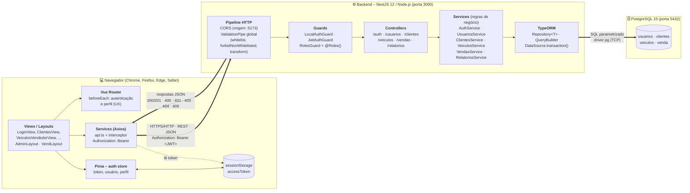
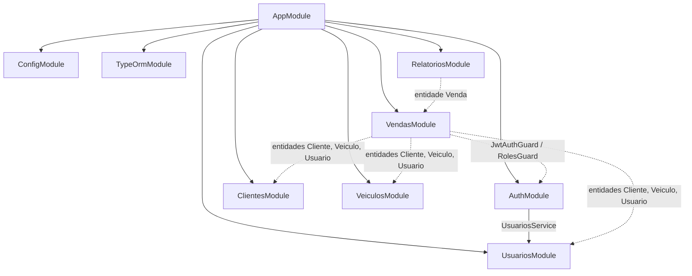
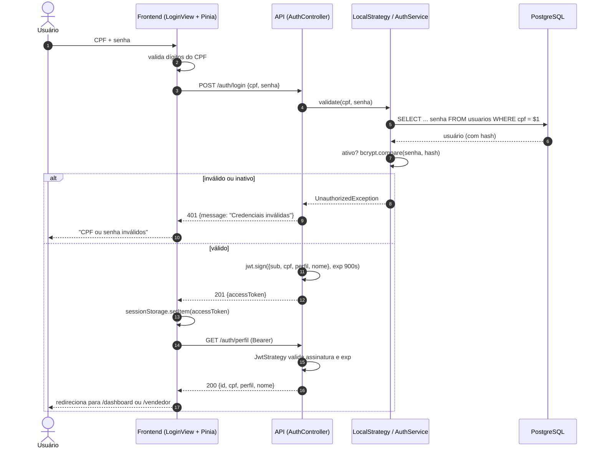
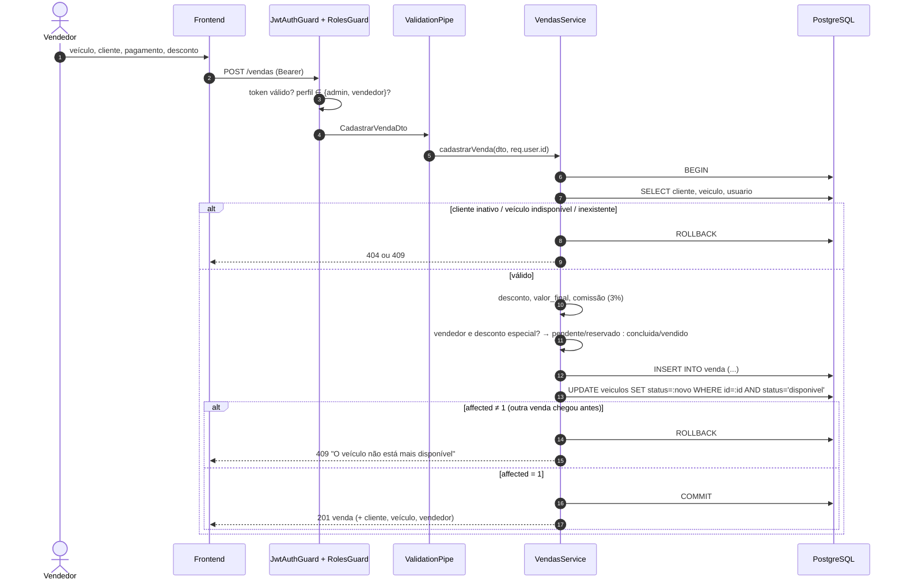
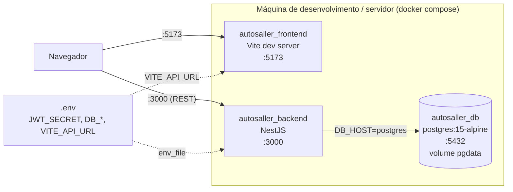

# 2. Arquitetura do Sistema — AutoSaller

## 2.1 Visão geral

O AutoSaller adota uma arquitetura **cliente-servidor em três camadas físicas** (*3-tier*):

1. **Apresentação:** uma SPA (*Single Page Application*) em Vue 3 executada no navegador.
2. **Aplicação:** uma API REST em NestJS sobre Node.js.
3. **Dados:** um banco relacional PostgreSQL.

O frontend nunca acessa o banco diretamente. Toda regra de negócio e toda autorização vivem no backend, e o frontend repete validações apenas para dar retorno imediato ao usuário.

No backend, o código segue uma **arquitetura em camadas por módulo de domínio** (*modular monolith*): cada módulo do NestJS (Usuários, Clientes, Veículos, Vendas, Relatórios, Auth) agrupa controller, service, DTOs e entidade. Isso atende ao RNF010 (código modular) e permite dividir o trabalho por fatia vertical.

| Atributo | Decisão | Justificativa |
|---|---|---|
| Estilo | Monólito modular + SPA | Equipe de 5 pessoas e 13 semanas; um único deploy, sem custo operacional de microsserviços |
| Comunicação | HTTP/1.1, REST, JSON (UTF-8) | Padrão universal, simples de testar (Supertest, Cypress) |
| Autenticação | JWT Bearer (HS256), *stateless*, 15 min | Dispensa sessão no servidor; o perfil viaja no token |
| Autorização | Guards por rota (`JwtAuthGuard` + `RolesGuard`) | RNF005: a validação acontece no servidor, inclusive para quem acessa a URL direta |
| Persistência | TypeORM 1.x (Data Mapper / Repository) | Mapeamento declarativo, transações via `DataSource.transaction` |
| Integridade | Transações + `UPDATE ... WHERE status = :esperado` | Evita venda dupla do mesmo veículo sem *lock* explícito (concorrência otimista) |
| Implantação | Docker Compose (3 contêineres) | Ambiente reproduzível; um único comando sobe tudo |

## 2.2 Diagrama de blocos (componentes e fluxo)



## 2.3 Descrição dos blocos

### 2.3.1 Camada de apresentação — Frontend (Vue 3 + TypeScript + Vite)

| Bloco | Arquivos | Responsabilidade |
|---|---|---|
| **Views** | `src/views/*.vue` | Telas e formulários. Validam a entrada no cliente (CPF por dígito verificador, placa, chassi, RENAVAM, faixas de filtro), exibem os erros devolvidos pela API e controlam os estados de carregamento. Usam atributos de acessibilidade (`aria-invalid`, `role="alert"`). |
| **Layouts** | `AdminLayout.vue`, `VendLayout.vue` | Estrutura de navegação por perfil: menus distintos para Administrador e Vendedor. |
| **Router** | `src/router/index.ts` | Rotas com `meta` (`requerAutenticacao`, `apenasAdministrador`, `apenasVendedor`). O `beforeEach` carrega o perfil, redireciona quem não está autenticado (preservando `redirect`) e envia cada perfil para sua área. É uma camada de **usabilidade**: a segurança real está nos *guards* do backend. |
| **Store (Pinia)** | `src/stores/auth.ts` | Estado da sessão: `token`, `usuario`, `autenticado`, `carregando`, `erro`. Ações `entrar`, `carregarPerfil` e `sair`. Traduz 401 em mensagem amigável. |
| **Services** | `src/services/*.service.ts` | Uma função por endpoint, com tipos TypeScript dos contratos. Também normalizam dados antes do envio (placa sem hífen, maiúsculas, preço numérico). |
| **Cliente HTTP** | `src/services/api.ts` | Instância Axios com `baseURL = VITE_API_URL` e interceptor que injeta `Authorization: Bearer <token>` lido do `sessionStorage`. |

**Decisão:** o token fica em `sessionStorage`, e não em `localStorage`. Ele é descartado ao fechar a aba, o que reduz a janela de uso indevido em computadores compartilhados da loja.

### 2.3.2 Camada de aplicação — Backend (NestJS 12 + TypeScript)

Toda requisição percorre o mesmo pipeline, na ordem: **CORS → Guards → Pipes → Controller → Service → Repositório/Transação → Exception Filter (padrão do Nest)**.

| Camada | Componentes | Responsabilidade | Não deve |
|---|---|---|---|
| **Bootstrap** | `main.ts` | Cria a aplicação; habilita CORS somente para `http://localhost:5173` com os métodos e cabeçalhos necessários; registra o `ValidationPipe` global. | — |
| **Guards** | `JwtAuthGuard`, `LocalAuthGuard`, `RolesGuard`, `@Roles()` | **Autenticação:** a Passport Strategy valida a assinatura e a expiração do JWT, ou CPF e senha no login. **Autorização:** compara `request.user.perfil` com os perfis declarados no handler. Falha → 401 ou 403. | Conter regra de negócio |
| **Pipes / DTOs** | `ValidationPipe`, `ParseIntPipe`, `*.dto.ts` | Transformam a entrada (*string* da URL → número; *trim*; maiúsculas) e validam a forma dos dados com `class-validator`. Removem e **rejeitam** campos não declarados (`forbidNonWhitelisted`), o que impede, por exemplo, enviar `status` ou `id_usuario` no corpo. Falha → 400 com lista de mensagens. | Acessar o banco |
| **Controllers** | `*.controller.ts` | Mapeiam rota e verbo HTTP para um método de serviço; extraem parâmetros, corpo e usuário autenticado (`req.user.id`). Ficam finos de propósito. | Calcular, decidir ou consultar diretamente |
| **Services** | `*.service.ts` | **Regras de negócio:** unicidade (CPF, e-mail, placa, chassi, RENAVAM), máquina de estados do veículo e da venda, cálculo de desconto e comissão (3%), desconto especial, validação de períodos, agregações de relatório. Lançam exceções HTTP semânticas (`NotFoundException`, `ConflictException`, `BadRequestException`). | Conhecer HTTP além das exceções |
| **Persistência** | TypeORM: `Repository<T>`, `QueryBuilder`, `EntityManager` | Mapeamento objeto-relacional das entidades `@Entity`; consultas parametrizadas, sem concatenar SQL (proteção contra *SQL injection*); transações `DataSource.transaction(cb)`. | — |
| **Configuração** | `ConfigModule` (`.env`) | `DB_*`, `JWT_SECRET`, `JWT_EXPIRES_IN_SECONDS`. A aplicação **não inicia sem `JWT_SECRET`** (falha segura). | — |

**Módulos de domínio e dependências**



`VendasModule` registra no TypeORM as entidades de Cliente, Veículo e Usuário para ler e atualizar essas tabelas **dentro da mesma transação**. Esse é o acoplamento deliberado que garante a baixa automática de estoque (RF-VEN-02). O módulo `estoque/` previsto no README corresponde, no código, ao módulo `veiculos/`.

### 2.3.3 Camada de dados — PostgreSQL 15

- O banco armazena as tabelas `usuarios`, `clientes`, `veiculos` e `venda`, com PK `SERIAL`, FKs `NOT NULL` de `venda` para as outras três e restrições `UNIQUE` (detalhes na [Estrutura de Dados](03-estrutura-de-dados.md)).
- Valores monetários usam `numeric(12,2)`, para evitar erro de ponto flutuante. O TypeORM os devolve como *string*, e os serviços formatam com `toFixed(2)`.
- Datas usam `timestamptz` (`data_criacao`, `atualizado_em`, `data_venda`), mantidas automaticamente pelo TypeORM.
- **Atenção:** `synchronize: true` faz o TypeORM alterar o esquema automaticamente a cada inicialização. Isso é aceitável em desenvolvimento, mas é arriscado em produção, porque pode apagar colunas. A recomendação para o M4 é desligar e usar *migrations* em `src/database/`.

## 2.4 Protocolos e contratos de comunicação

| Trecho | Protocolo | Formato | Segurança |
|---|---|---|---|
| Navegador → Frontend (Vite) | HTTP(S) :5173 | HTML, JS, CSS | — |
| Frontend → API | HTTP(S) :3000, REST | `application/json; charset=utf-8` | `Authorization: Bearer <JWT>`; CORS restrito à origem do frontend |
| API → Banco | TCP :5432, protocolo do PostgreSQL (driver `pg`) | SQL parametrizado | Credenciais via `.env`; banco não exposto ao navegador |

**Convenções REST adotadas**

| Verbo | Uso | Sucesso | Exemplos |
|---|---|---|---|
| `GET` | Consulta (sem efeitos colaterais); filtros na *query string* | 200 | `GET /veiculos?marca=fiat&precoMax=80000` |
| `POST` | Criação de recurso ou ação de login | 201 | `POST /clientes`, `POST /vendas` |
| `PATCH` | Alteração parcial ou transição de estado em sub-recurso | 200 | `PATCH /veiculos/7/status`, `PATCH /vendas/5/aprovar` |

**Formato padronizado de erro** (gerado pelo Nest a partir das exceções):

```json
{ "statusCode": 409, "message": "Placa, chassi ou RENAVAM já cadastrado", "error": "Conflict" }
```

Em erros de validação, `message` é um *array* com uma mensagem por regra violada. O frontend junta essas mensagens na exibição (`mensagemErroApi`).

| Código | Quando |
|---|---|
| 400 Bad Request | DTO inválido, campo não permitido, id não inteiro, faixa de preço ou período invertido |
| 401 Unauthorized | Sem token, token inválido ou expirado, credenciais incorretas |
| 403 Forbidden | Perfil sem permissão para a rota |
| 404 Not Found | Recurso inexistente |
| 409 Conflict | Duplicidade, estado incompatível (veículo indisponível, cliente inativo, venda não pendente) ou concorrência |
| 500 | Erro não tratado (ver DEF-05, DEF-06) |

## 2.5 Catálogo de endpoints

| Método e rota | Perfis | Corpo / query | Resposta |
|---|---|---|---|
| `POST /auth/login` | público | `{cpf, senha}` | `{accessToken}` |
| `GET /auth/perfil` | autenticado | — | `{id, cpf, perfil, nome}` |
| `GET /usuarios` · `GET /usuarios/:id` | admin | — | Usuário(s) sem senha |
| `POST /usuarios` | admin | `{nome, cpf, senha, perfil}` | Usuário criado |
| `PATCH /usuarios/:id/inativar` | admin | `{cpf}` | Usuário inativado |
| `GET /clientes?busca=` · `GET /clientes/:id` | admin, vendedor | — | Cliente(s) |
| `POST /clientes` · `PATCH /clientes/:id` | admin, vendedor | dados do cliente | Cliente |
| `PATCH /clientes/:id/inativar` | admin, vendedor | — | Cliente inativado |
| `GET /veiculos` | admin, vendedor | `marca, modelo, precoMin, precoMax, ano, combustivel, status` | Veículo[] |
| `GET /veiculos/:id` | admin, vendedor | — | Veículo |
| `POST /veiculos` · `PATCH /veiculos/:id` | admin, vendedor ⚠ | dados do veículo | Veículo |
| `PATCH /veiculos/:id/status` | admin, vendedor ⚠ | `{status}` | Veículo |
| `POST /vendas` | admin, vendedor | `{id_cliente, id_veiculo, forma_pagamento, percentual_desconto?}` | Venda com relações |
| `GET /vendas?cliente_id=&dataInicio=&dataFim=` · `GET /vendas/:id` | admin, vendedor | — | Venda(s) com relações |
| `PATCH /vendas/:id/aprovar` · `/rejeitar` | admin | — | Venda |
| `GET /relatorios/faturamento?dataInicio=&dataFim=` | admin, vendedor | — | `[{ano, mes, quantidade_vendas, faturamento_total}]` |

⚠ = diverge do requisito (DEF-04).

## 2.6 Diagramas de sequência

### Autenticação e acesso a rota protegida (UC01)



### Registrar venda com desconto e baixa de estoque (UC13 + UC14)



## 2.7 Visão de implantação



O frontend é servido ao navegador, e é o **navegador** que chama a API em `VITE_API_URL`, não o contêiner do frontend. Por isso o backend precisa estar acessível a partir da máquina do usuário, e o CORS precisa listar a origem do frontend. No deploy em nuvem, a origem fixa em `main.ts` deve passar a vir do `.env`.

## 2.8 Requisitos não funcionais × arquitetura

| RNF | Mecanismo arquitetural | Situação |
|---|---|---|
| RNF001 Responsivo | CSS com *flex/grid*; teste E2E de largura 390 px | ✅ |
| RNF003 Consultas ≤ 2 s | Filtros aplicados no SQL (QueryBuilder), não em memória | ✅ (falta medir com massa de dados) |
| RNF004 Senha com hash | bcrypt custo 10 | ✅ (mas o hash vaza em `/vendas`, DEF-07) |
| RNF005 Acesso por perfil | Guards no backend + *guards* de rota no frontend | 🟡 DEF-04 |
| RNF006 Dados de clientes restritos | Todas as rotas `/clientes` exigem JWT | ✅ |
| RNF007 Log de auditoria | Interceptor em `common/` + tabela `log_auditoria` | ⚪ planejado |
| RNF010 Código modular | Módulos Nest por domínio; camadas controller/service/repository | ✅ |
