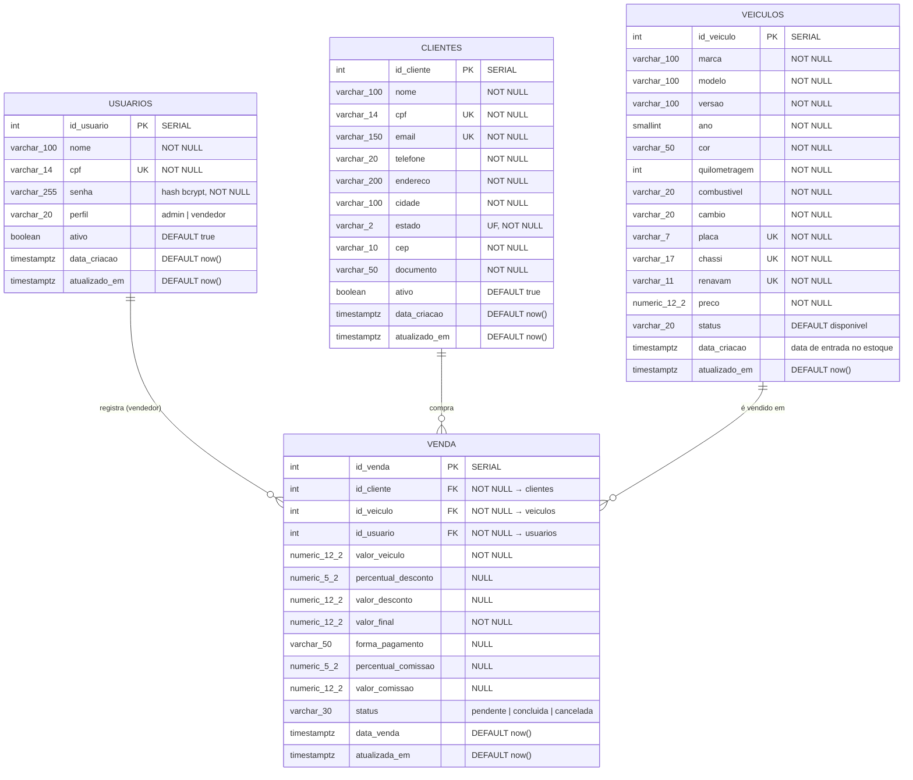
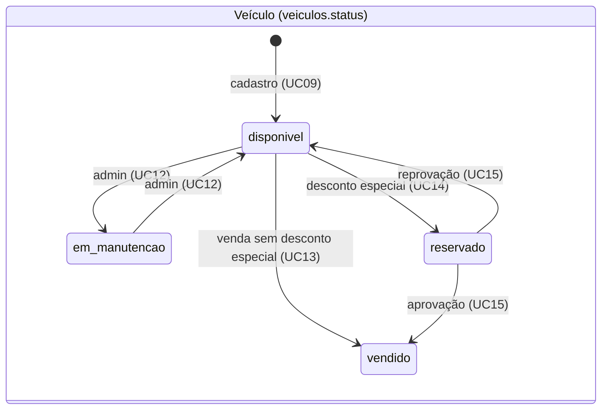
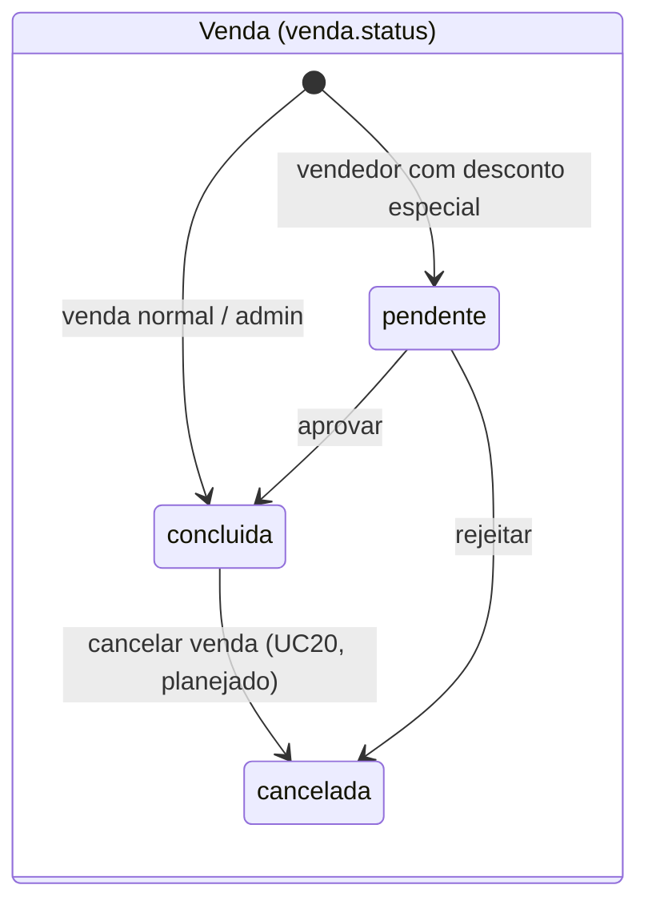
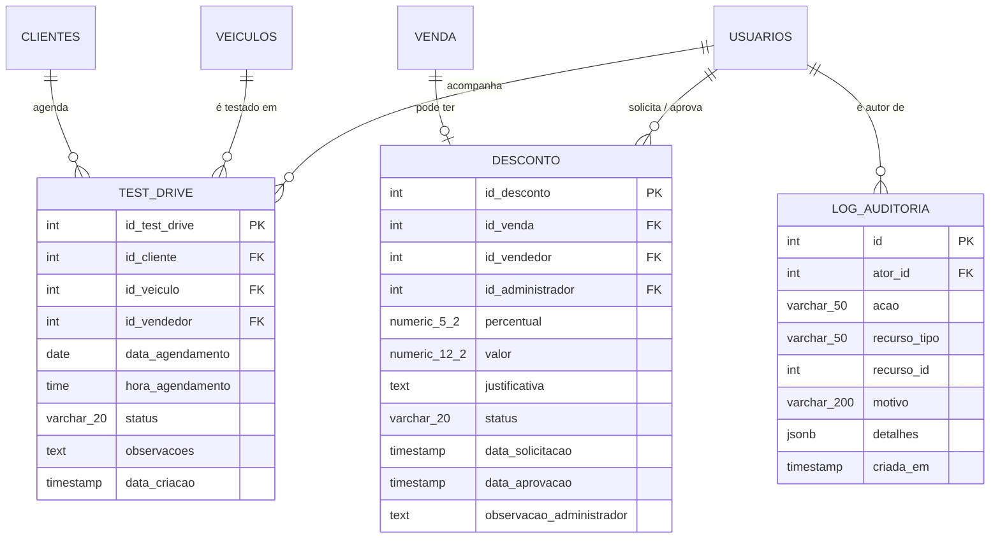
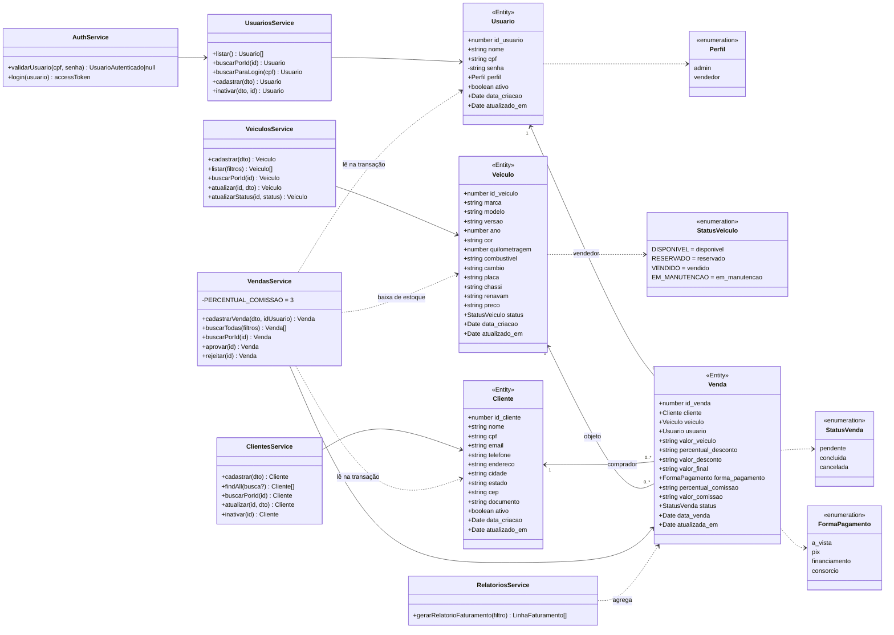

# 3. Estrutura de Dados — AutoSaller

Este documento traz duas visões complementares:

- **DER (modelo físico):** tabelas, colunas, chaves e cardinalidades, extraídas das entidades TypeORM (`*.entity.ts`), que definem o esquema real do banco (`synchronize: true`).
- **Diagrama de classes:** entidades de domínio, enumerações e serviços que operam sobre elas.

Ao final, há um quadro comparativo com o DER publicado em `docs/Diagrama DER AutoSeller.pdf`, que representa o modelo **planejado**.

## 3.1 Diagrama Entidade-Relacionamento — esquema implementado

Notação: pé-de-galinha (Crow's Foot). `||` = exatamente um; `o{` = zero ou muitos. PK = chave primária, FK = chave estrangeira, UK = única.

> Nos diagramas, `varchar_100` significa `varchar(100)` e `numeric_12_2` significa `numeric(12,2)`. O Mermaid não aceita parênteses no tipo do atributo.

### 3.1.1 Cardinalidades e regras dos relacionamentos

| Relacionamento | Cardinalidade | FK | Integridade referencial | Regra de negócio associada |
|---|---|---|---|---|
| **Usuário registra Venda** | 1 : 0..N — um usuário registra zero ou muitas vendas; toda venda tem exatamente um vendedor | `venda.id_usuario → usuarios.id_usuario`, `NOT NULL` | `ON DELETE NO ACTION` (padrão). Usuários nunca são excluídos, só inativados, então o histórico é preservado (RF-USU-15). | O vendedor é sempre o usuário do token (`req.user.id`), nunca um campo do corpo. |
| **Cliente compra Venda** | 1 : 0..N | `venda.id_cliente → clientes.id_cliente`, `NOT NULL` | Idem. Clientes são inativados logicamente (RF-CLI-04). | Só um cliente `ativo` pode ser associado a uma nova venda. |
| **Veículo é vendido em Venda** | 1 : 0..N — o mesmo veículo pode aparecer em várias vendas ao longo do tempo (ex.: uma venda cancelada por reprovação de desconto, depois uma concluída) | `venda.id_veiculo → veiculos.id_veiculo`, `NOT NULL` | Idem. | **No máximo uma venda não cancelada por veículo.** Isso é garantido pela máquina de estados do veículo (`disponivel` → `reservado`/`vendido`) com `UPDATE ... WHERE status = 'disponivel'`, e não por constraint. Uma melhoria possível é um índice único parcial: `CREATE UNIQUE INDEX ON venda(id_veiculo) WHERE status <> 'cancelada'`. |

**Grau de normalização:** o esquema está na 3FN. Os atributos não-chave dependem apenas da PK, e não há grupos repetidos. Os valores `valor_veiculo`, `valor_desconto`, `valor_final` e `valor_comissao` são **redundâncias intencionais**: congelam os valores do momento da venda, porque o preço do veículo e o percentual de comissão podem mudar depois. Isso preserva o histórico e não viola a 3FN.

### 3.1.2 Máquinas de estado armazenadas

## 3.2 Dicionário de dados

Convenções da coluna **Restrições**: `PK` chave primária, `FK` chave estrangeira, `UK` única, `NN` NOT NULL, `DF` valor padrão. A coluna **Validação na API** resume o DTO correspondente.

### `usuarios` — funcionários com acesso ao sistema

| Coluna | Tipo | Restrições | Descrição | Validação na API |
|---|---|---|---|---|
| `id_usuario` | `integer` (SERIAL) | PK | Identificador | — |
| `nome` | `varchar(100)` | NN | Nome completo | obrigatório, ≤ 100 |
| `cpf` | `varchar(14)` | NN, UK | CPF, usado como login | exatamente 11 dígitos |
| `senha` | `varchar(255)` | NN | Hash bcrypt (60 caracteres), nunca o texto | 6–255 caracteres (antes do hash) |
| `perfil` | `varchar(20)` | NN | `admin` \| `vendedor` | `IsIn` |
| `ativo` | `boolean` | NN, DF `true` | `false` = acesso bloqueado | — |
| `data_criacao` | `timestamptz` | NN, DF `now()` | Data de cadastro | — |
| `atualizado_em` | `timestamptz` | NN, DF `now()` | Última alteração | — |

### `clientes` — compradores e interessados

| Coluna | Tipo | Restrições | Descrição | Validação na API |
|---|---|---|---|---|
| `id_cliente` | `integer` (SERIAL) | PK | Identificador | — |
| `nome` | `varchar(100)` | NN | Nome | 3–100 |
| `cpf` | `varchar(14)` | NN, UK | CPF | 11 caracteres |
| `email` | `varchar(150)` | NN, UK | E-mail de contato | `IsEmail` |
| `telefone` | `varchar(20)` | NN | Telefone com DDD | 10–15 |
| `endereco` | `varchar(200)` | NN | Logradouro e número | 5–150 |
| `cidade` | `varchar(100)` | NN | Cidade | 2–50 |
| `estado` | `varchar(2)` | NN | UF | exatamente 2 |
| `cep` | `varchar(10)` | NN | CEP | exatamente 8 |
| `documento` | `varchar(50)` | NN | RG ou CNH | 5–20 |
| `ativo` | `boolean` | NN, DF `true` | Inativação lógica | — |
| `data_criacao` | `timestamptz` | NN, DF `now()` | Cadastro | — |
| `atualizado_em` | `timestamptz` | NN, DF `now()` | Última alteração | — |

### `veiculos` — estoque

| Coluna | Tipo | Restrições | Descrição | Validação na API |
|---|---|---|---|---|
| `id_veiculo` | `integer` (SERIAL) | PK | Identificador | — |
| `marca` | `varchar(100)` | NN | Fabricante | *trim*, não vazio, ≤ 100 |
| `modelo` | `varchar(100)` | NN | Modelo | idem |
| `versao` | `varchar(100)` | NN | Versão ou acabamento | idem |
| `ano` | `smallint` | NN | Ano do modelo | inteiro, 1886–ano atual |
| `cor` | `varchar(50)` | NN | Cor | não vazio, ≤ 50 |
| `quilometragem` | `integer` | NN | km rodados | 0–2.000.000 |
| `combustivel` | `varchar(20)` | NN | `gasolina`, `etanol`, `flex`, `diesel`, `eletrico`, `hibrido` | `IsIn` |
| `cambio` | `varchar(20)` | NN | `manual`, `automatico`, `cvt`, `automatizado` | `IsIn` |
| `placa` | `varchar(7)` | NN, UK | Placa, armazenada sem hífen | `^[A-Z]{3}\d{4}$` ou Mercosul `^[A-Z]{3}\d[A-Z0-9]\d{2}$` |
| `chassi` | `varchar(17)` | NN, UK | VIN | 17 caracteres `[A-HJ-NPR-Z0-9]` (sem I, O, Q) |
| `renavam` | `varchar(11)` | NN, UK | Registro nacional | 11 dígitos |
| `preco` | `numeric(12,2)` | NN | Preço de venda | > 0, até 2 decimais |
| `status` | `varchar(20)` | NN, DF `disponivel` | `disponivel`, `reservado`, `vendido`, `em_manutencao` | `IsEnum(StatusVeiculo)` |
| `data_criacao` | `timestamptz` | NN, DF `now()` | Entrada no estoque | — |
| `atualizado_em` | `timestamptz` | NN, DF `now()` | Última alteração | — |

### `venda` — transações comerciais

| Coluna | Tipo | Restrições | Descrição | Origem do valor |
|---|---|---|---|---|
| `id_venda` | `integer` (SERIAL) | PK | Identificador | — |
| `id_cliente` | `integer` | FK → `clientes`, NN | Comprador | corpo (`id_cliente ≥ 1`) |
| `id_veiculo` | `integer` | FK → `veiculos`, NN | Veículo vendido | corpo (`id_veiculo ≥ 1`) |
| `id_usuario` | `integer` | FK → `usuarios`, NN | Vendedor responsável | **JWT** (`sub`) |
| `valor_veiculo` | `numeric(12,2)` | NN | Preço no momento da venda | `veiculos.preco` |
| `percentual_desconto` | `numeric(5,2)` | — | % de desconto | corpo, 0–100, padrão 0 |
| `valor_desconto` | `numeric(12,2)` | — | Desconto em R$ | `preço × %` |
| `valor_final` | `numeric(12,2)` | NN | Valor pago | `preço − desconto` |
| `forma_pagamento` | `varchar(50)` | — | `a_vista`, `pix`, `financiamento`, `consorcio` | corpo (`IsIn`) |
| `percentual_comissao` | `numeric(5,2)` | — | % de comissão | constante 3,00 |
| `valor_comissao` | `numeric(12,2)` | — | Comissão em R$ | `3% × valor_final` |
| `status` | `varchar(30)` | NN | `pendente`, `concluida`, `cancelada` | regra do UC13/UC14/UC15 |
| `data_venda` | `timestamptz` | NN, DF `now()` | Data e hora da venda | automático |
| `atualizada_em` | `timestamptz` | NN, DF `now()` | Última alteração (ex.: aprovação) | automático |

**Exemplo de cálculo (RF-VEN-04):** veículo de R$ 80.000,00 com 5% de desconto → `valor_desconto` = 4.000,00, `valor_final` = 76.000,00, `valor_comissao` = 2.280,00. O mesmo caso está coberto por teste automatizado.

## 3.3 Entidades planejadas (DER de referência)

As tabelas a seguir constam no DER do planejamento, mas ainda não existem no código.

**Observação sobre `DESCONTO`:** o DER antigo (`…-OLD.pdf`) tinha essa tabela; o DER atual a removeu. A implementação seguiu o DER atual: o desconto especial é representado por `venda.status = 'pendente'`. Com isso, **não ficam registrados quem aprovou, quando e com qual justificativa**. Essas informações são exigidas para auditoria (RF-USU-16), então devem ir para `log_auditoria` ou para a tabela `desconto`. Essa decisão precisa ser registrada em `docs/decisoes-arquiteturais/`.

## 3.4 Diagrama de classes (domínio e serviços)

**Notas de modelagem**
- `senha` aparece como privado (`-`) porque o domínio nunca deveria expô-la. Na prática, ela vaza nas respostas de vendas (DEF-07); a correção é `@Column({ select: false })`.
- `preco` e os valores monetários são `string` no TypeScript porque o driver `pg` devolve `numeric` como texto, para não perder precisão. Os serviços convertem com `Number()` apenas para calcular e gravam com `toFixed(2)`.
- Os relacionamentos são **unidirecionais** (`@ManyToOne` em `Venda`). `Cliente`, `Veiculo` e `Usuario` não têm a coleção inversa, porque o histórico é consultado a partir de `venda`.

## 3.5 DER planejado × esquema implementado

| Item | DER (PDF) | Implementado | Impacto / ação sugerida |
|---|---|---|---|
| Nomes das tabelas | `USUARIO`, `CLIENTE`, `VEICULO`, `VENDA` | `usuarios`, `clientes`, `veiculos`, `venda` | Padronizar o plural e atualizar o PDF |
| FK do vendedor | `venda.id_vendedor` | `venda.id_usuario` | Atualizar o DER |
| `venda.condicoes_pagamento`, `venda.observacoes` | existem | **ausentes** | RF-VEN-03 pede “condições de negociação”: adicionar `condicoes_pagamento text` |
| `veiculos.data_entrada` / `data_atualizacao` | existem | `data_criacao` / `atualizado_em` | Equivalentes; ajustar os nomes no DER |
| `clientes.data_cadastro` | existe | `data_criacao` | Idem |
| Tamanhos | `marca varchar(50)`, `placa varchar(10)`, `chassi varchar(30)`, `renavam varchar(20)`, `ano integer` | `varchar(100)`, `varchar(7)`, `varchar(17)`, `varchar(11)`, `smallint` | O código é mais preciso (placa 7, VIN 17, RENAVAM 11); atualizar o DER |
| `TEST_DRIVE`, `LOG_AUDITORIA` | existem | não implementadas | Fatias planejadas |
| `DESCONTO` | só no DER antigo | representada por `venda.status` | Registrar a decisão e garantir a auditoria |
